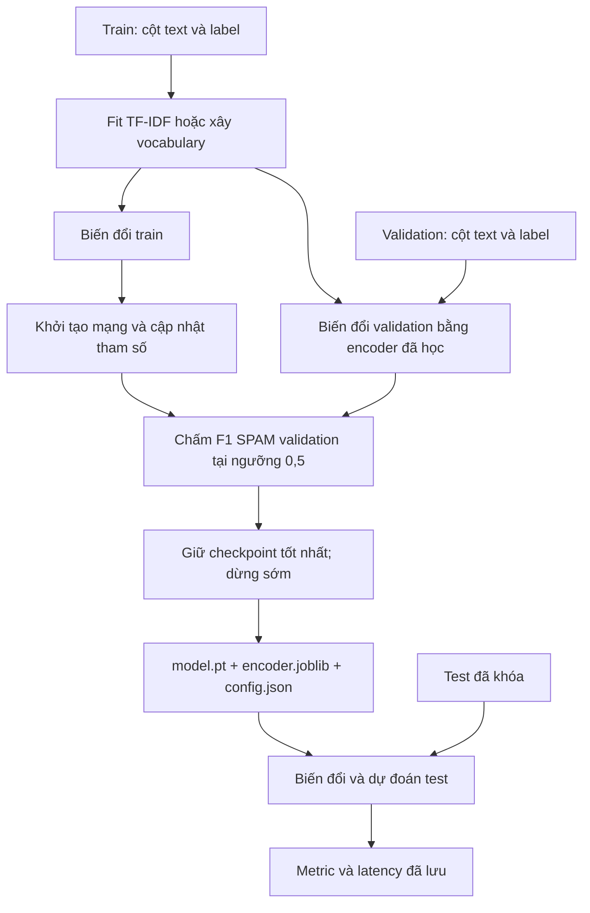
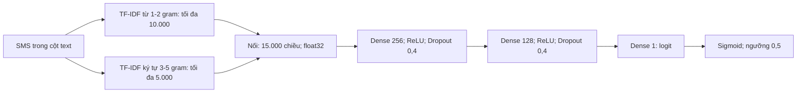
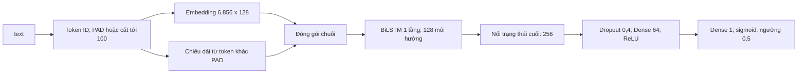
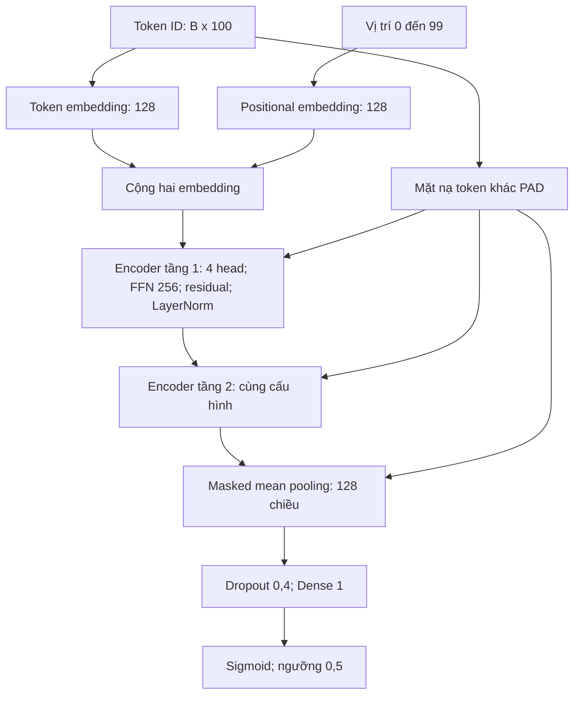

# CHƯƠNG 3 — THIẾT KẾ MÔ HÌNH VÀ QUY TRÌNH HUẤN LUYỆN

## 3.1. Thiết kế tổng thể và mức bằng chứng

Ba phương án có chung nhiệm vụ tạo một logit SPAM, dùng cùng dữ liệu đã lưu và cùng ngưỡng $0{,}5$. MLP khác hai mô hình chuỗi ở cả biểu diễn đầu vào và kiến trúc. Do đó, phép so sánh là giữa ba pipeline hoàn chỉnh, không phải thí nghiệm chỉ thay một khối mạng trong khi mọi điều kiện khác bất biến.

Chương sử dụng `eval/results/baseline/<kind>/config.json` cho giá trị của lượt chạy chính; sử dụng `models/common.py` và ba script `train.py` để mô tả cơ chế triển khai. Lượt chạy chính được huấn luyện bằng chính mã hiện tại, nên các chi tiết không có trường riêng trong config, như dropout hoặc vị trí LayerNorm, khớp với lượt chạy đó.

**Hình 3.1. Luồng thực nghiệm chung và vai trò của ba tập dữ liệu.**

*Nguồn: biên soạn từ `train`, `load_checkpoint` trong `models/common.py` và `evaluate` trong `eval/evaluate.py`; sơ đồ mô tả thiết kế mã, không phải nhật ký thực thi mới.*

## 3.2. MLP trên đặc trưng TF-IDF

Đầu vào một batch có dạng $B\times15000$, với $B$ là số SMS trong batch. Mỗi hàng là vector nối TF-IDF từ và ký tự. MLP biến đổi 15.000 chiều xuống 256 rồi 128 chiều bằng các lớp Dense, ReLU và dropout trước khi sinh một logit. Hai lớp ẩn cho phép học tương tác phi tuyến giữa các đặc trưng, trong khi ý nghĩa vị trí từ đã được quyết định bởi cách tạo n-gram trước đó.

**Hình 3.2. Kiến trúc MLP hiện tại.**

*Nguồn: `feature_encoder`, `transform_texts`, `MLPClassifier` trong `models/common.py`; số đặc trưng thực tế từ `eval/results/baseline/mlp/config.json`.*

Số tham số có thể đối chiếu từ kích thước lớp:

$$
(15000\times256+256)+(256\times128+128)+(128\times1+1)=3.873.281. \tag{3.1}
$$

Số này khớp config và JSON kết quả. Phần lớn tham số nằm ở lớp đầu vì số chiều TF-IDF lớn. Vectorizer còn giữ từ vựng và IDF trong `encoder.joblib`; các dữ liệu đó không được tính vào 3.873.281 tham số mạng. MLP không có `max_len` theo token hoặc embedding, nên các trường đó ghi `n/a` trong bảng so sánh.

## 3.3. LSTM hai chiều

Đầu vào là tensor số nguyên $B\times100$. Embedding biến nó thành $B\times100\times128$. Mặt nạ `tokens.ne(0)` xác định vị trí nội dung; tổng mặt nạ cho chiều dài thật. Hàm `pack_padded_sequence` đóng gói chuỗi theo các chiều dài này với `enforce_sorted=False`, không yêu cầu người gọi tự sắp xếp SMS theo độ dài [6].

BiLSTM có một tầng hồi tiếp, hidden size 128 mỗi hướng. Sau khi mã hóa, chương trình lấy hai trạng thái ẩn cuối `hidden[-2]`, `hidden[-1]` và nối theo chiều đặc trưng. Vector 256 chiều đi qua dropout 0,4, Dense 64, ReLU và Dense 1. Không có attention bổ sung hoặc phép mean pooling trong nhánh này.

**Hình 3.3. Kiến trúc BiLSTM và cách xử lý padding.**

*Nguồn: `SequenceClassifier.forward` trong `models/common.py`; kích thước vocabulary/embedding/hidden/max_len từ `eval/results/baseline/lstm/config.json`.*

Số tham số embedding là $6856\times128=877.568$. Với bốn khối cổng, mỗi hướng LSTM có $4\times128\times128$ trọng số đầu vào, cùng số trọng số hồi tiếp, và hai vector bias kích thước $4\times128$ theo tổ chức PyTorch. Hai hướng có 264.192 tham số. Đầu phân loại có $(256\times64+64)+(64+1)=16.513$. Tổng là $877.568+264.192+16.513=1.158.273$, khớp config. Đếm này gồm toàn bộ bảng embedding kể cả hàng PAD; không đồng nghĩa mọi phần tử đều được cập nhật như nhau.

## 3.4. Transformer encoder nhỏ học từ đầu

Mô hình dùng cùng kích thước đầu vào $B\times100$ và vocabulary 6.856 như BiLSTM trong config. Bảng token embedding có 128 chiều; bảng positional embedding có 100 vị trí và cùng số chiều. Hai vector được cộng rồi đi qua hai `TransformerEncoderLayer` của PyTorch. Cấu hình mỗi tầng là `d_model=128`, `nhead=4`, `dim_feedforward=256`, dropout 0,1, `batch_first=True`, `norm_first=False` và ReLU mặc định [8].

**Hình 3.4. Kiến trúc Transformer encoder và hai vai trò của mặt nạ.**

*Nguồn: `SequenceClassifier` trong `models/common.py`; vocabulary, embedding, hidden, max_len từ `eval/results/baseline/transformer/config.json`. Các khối nội bộ encoder dựa trên lớp thư viện được mã gọi.*

`src_key_padding_mask=~mask` ngăn attention dùng các key PAD. Sau hai tầng, `masked mean pooling` chỉ lấy trung bình các vị trí nội dung. Chỉ truyền mask vào encoder chưa đủ thay thế bước loại PAD khỏi trung bình, bởi các vị trí đệm vẫn có thể có đầu ra trung gian. Mã không sử dụng token tổng hợp riêng, không có decoder và không nạp bất kỳ checkpoint pretrained nào.

Số tham số cũng phù hợp cấu trúc trên: token embedding 877.568; positional embedding 12.800; mỗi encoder 132.480; hai encoder 264.960; Dense cuối 129. Tổng $877.568+12.800+264.960+129=1.155.457$. Trong mỗi encoder, attention có 66.048 tham số, FFN có 65.920 và hai LayerNorm có 512. Phép đếm là đối chiếu cấu trúc với metadata đã lưu, không thay cho kiểm tra tương thích khi nạp checkpoint.

## 3.5. Cấu hình đối chiếu ba mô hình

**Bảng 3.1. Đầu vào và cấu trúc ba phương án.**

| Thuộc tính | MLP | BiLSTM | Transformer |
|---|---|---|---|
| Tên khóa mô hình | `mlp` | `lstm` | `transformer` |
| Kiểu đầu vào | `tfidf_word_char` | `token_ids` | `token_ids` |
| Feature/vocabulary thực tế | 15.000 đặc trưng | 6.856 mục | 6.856 mục |
| Giới hạn xây biểu diễn | Từ tối đa 10.000; ký tự tối đa 5.000 | Vocabulary tối đa 10.000 gồm PAD/UNK | Như BiLSTM |
| `max_len` | n/a | 100 token | 100 token |
| Embedding token | n/a | 128, học từ đầu | 128, học từ đầu |
| Embedding vị trí | n/a | n/a | 100 × 128, học từ đầu |
| Khối ẩn chính | Dense 256 → Dense 128 | 1 tầng BiLSTM, hidden 128 mỗi hướng | 2 encoder, hidden 128, 4 head, FFN 256 |
| Tổng hợp chuỗi | n/a | Nối hai trạng thái ẩn cuối, 256 chiều | Masked mean, 128 chiều |
| Đầu phân loại | Dense 128 → 1 | Dense 256 → 64 → 1 | Dense 128 → 1 |
| Dropout | 0,4 sau mỗi Dense ẩn | 0,4 trước Dense 64 | 0,1 trong encoder; 0,4 trước Dense cuối |

*Nguồn: kích thước thực tế và các trường embedding/hidden/max_len từ ba config trong `eval/results/baseline/`; giới hạn feature, số tầng/head, dropout và cách pooling từ `models/common.py` hiện tại. `n/a` là không áp dụng.*

**Bảng 3.2. Cấu hình huấn luyện đã lưu và cơ chế theo mã hiện tại.**

| Thuộc tính | MLP | BiLSTM | Transformer |
|---|---|---|---|
| Optimizer | Adam | Adam | AdamW |
| Learning rate trong config | 0,001 | 0,001 | 0,001 |
| Lịch learning rate theo mã | Giữ giá trị khởi tạo | Giữ giá trị khởi tạo | Warmup khoảng 10% bước, rồi giảm tuyến tính |
| Batch size huấn luyện | 64 | 64 | 64 |
| Epoch yêu cầu | 10 | 10 | 10 |
| Epoch đã chạy | 10 | 10 | 7 |
| Epoch checkpoint tốt nhất | 8 | 8 | 4 |
| Patience | 3 | 3 | 3 |
| Seed | 42 | 42 | 42 |
| Ngưỡng quyết định | 0,5 | 0,5 | 0,5 |
| Chọn checkpoint | F1 SPAM validation cao nhất; giữ epoch đầu nếu hòa | Như MLP | Như MLP |
| F1 SPAM validation tốt nhất | 95,41% | 94,50% | 91,07% |
| Pretrained | Không | Không | Không |

*Nguồn: `eval/results/baseline/{mlp,lstm,transformer}/config.json`; lịch learning rate và việc khởi tạo từ đầu theo mã `models/common.py`. F1 validation làm tròn hai chữ số phần trăm; đây không phải kết quả test.*

Các script mặc định 10 epoch, batch 64, seed 42 và đọc `data/splits/train.csv`. Lượt chạy chính truyền `--train-file data/splits/train_base.csv --output-dir eval/results/baseline/<kind>`; lượt augmented dùng train mặc định và lưu vào `models/<kind>/checkpoint`. Config ghi lại `train_file` và `train_examples` để phân biệt hai lượt.

## 3.6. Huấn luyện, loss và lựa chọn checkpoint

Mã đặt seed cho `random`, NumPy và PyTorch, đồng thời tạo `torch.Generator` riêng cho DataLoader xáo trộn train. Cách này giảm phụ thuộc của thứ tự batch vào các lời gọi bộ sinh ngẫu nhiên toàn cục. Tuy nhiên, seed đơn lẻ không bảo đảm kết quả bit giống nhau giữa mọi phiên bản thư viện hoặc thiết bị; hồ sơ chưa lưu đầy đủ điều kiện để kiểm chứng điều đó.

Sau khi fit encoder trên train, mã biến đổi train/validation, tạo mạng và `BCEWithLogitsLoss` với `pos_weight=3377/523`. MLP/BiLSTM dùng Adam, Transformer dùng AdamW. Mỗi batch thực hiện `zero_grad`, forward, tính loss, `backward` và `step`. Mã hiện tại không gọi `.cuda()` hoặc `.to(device)`; lượt chạy chính huấn luyện hoàn toàn trên CPU.

Lịch Transformer tính tổng bước dự kiến $S=\text{epochs requested}\times\text{len(loader)}$. Với train 3.900, batch 64 và không bỏ batch cuối, có 61 batch/epoch, nên ngân sách 10 epoch tương ứng 610 bước; warmup theo mã là $\max(1,\lfloor0{,}1S\rfloor)=61$ bước. Các số này là tính từ mã và cấu hình, không phải log từng bước đã lưu. Khi dừng sớm ở epoch 7, lịch được tính theo ngân sách ban đầu, không được co lại thành lịch bảy epoch.

Cuối mỗi epoch, mô hình chuyển sang `eval()`, suy luận validation trong `torch.inference_mode()`, áp dụng sigmoid và ngưỡng 0,5 rồi tính F1 SPAM. Khi `val_f1 > best_f1`, mã sao chép trạng thái tốt nhất và đặt lại số epoch không cải thiện. Khi bằng hoặc thấp hơn, bộ đếm tăng; đạt patience 3 thì dừng. Do so sánh nghiêm ngặt, epoch hòa điểm không ghi đè checkpoint cũ.

Transformer lưu epoch tốt nhất 4 và chạy tổng 7 epoch, phù hợp với chính sách dừng sau ba epoch không cải thiện. MLP và BiLSTM tốt nhất ở epoch 8 và chạy đến giới hạn 10, vì epoch 9–10 chưa đủ ba lần liên tiếp không cải thiện. Script in F1 validation mỗi epoch ra màn hình, nhưng giá trị đó chưa được lưu thành artifact; báo cáo không dựng learning curve.

## 3.7. Artifact và quy trình suy luận

Theo cơ chế lưu trong mã hiện tại, mỗi lượt train ghi ba thành phần: `model.pt` chứa `state_dict` của checkpoint tốt nhất; `encoder.joblib` chứa TF-IDF hoặc ánh xạ token ID; `config.json` chứa cấu hình, epoch, F1 validation, số tham số và thời gian train. Ba loại tệp có trong mỗi thư mục `eval/results/baseline/<kind>` và đã được nạp lại thành công khi đánh giá. Lưu trọng số cùng encoder là cần thiết vì đổi thứ tự đặc trưng/ID trong khi giữ mạng sẽ làm thay đổi ý nghĩa đầu vào.

Theo `load_checkpoint`, chương trình đọc config, kiểm tra trường `kind`, dựng kiến trúc tương ứng, nạp trọng số bằng `torch.load(..., map_location="cpu", weights_only=True)`, rồi gọi `eval()` và nạp encoder. Đây là cơ chế lưu/nạp `state_dict` phù hợp hướng dẫn PyTorch [16]. Mã suy luận biến đổi văn bản bằng encoder đã có, tính logit trong `inference_mode`, dùng sigmoid rồi ngưỡng từ config.

Trong lần cập nhật này, `eval/evaluate.py` đã nạp ba checkpoint baseline và ba checkpoint augmented để chấm cả ba tập test, và website đã nạp checkpoint Transformer demo. Điều đó xác nhận checkpoint tương thích với PyTorch 2.15.0 trên máy thử nghiệm.

## 3.8. Môi trường huấn luyện và khả năng tái lập

Lượt chạy chính được huấn luyện cục bộ trên CPU Intel Core i7-12700H (RAM 31,7 GB, Windows 11) với Python 3.11.9, PyTorch 2.15.0+cpu, scikit-learn 1.7.2 và NumPy 2.4.6, trong môi trường `eval/.venv` tạo bằng `eval/setup_env.py`. Lượt chạy trước đó trên Google Colab (`outputs/`) không có notebook, log thiết bị hay phiên bản package; kết quả của nó chỉ được dùng để đối chiếu ở mục 4.6.

Thời gian `train_seconds` trong mã bắt đầu ngay trước vòng lặp epoch và kết thúc sau vòng lặp; gồm train và validation. Nó không bao gồm đọc/fit/vector hóa ban đầu hoặc ghi artifact sau đó. Các giá trị 8,909; 29,752; 104,944 giây đo trên máy nêu trên, mỗi mô hình một lần.

`eval/requirements.txt` khai báo NumPy từ 1.24, scikit-learn 1.7.2, joblib từ 1.5.0 và PyTorch từ 2.1, không chốt phiên bản chính xác; Flask cần cài thêm cho website. Để tái lập chặt hơn nên chốt phiên bản trong requirements, lưu hash split/encoder và lưu lịch sử F1 từng epoch vào config.
