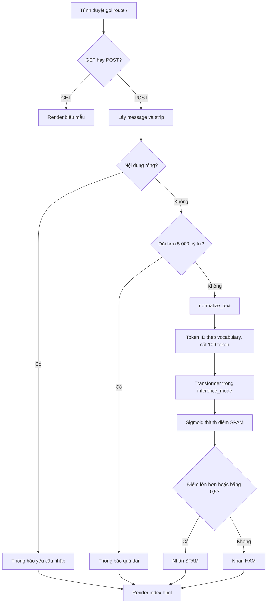
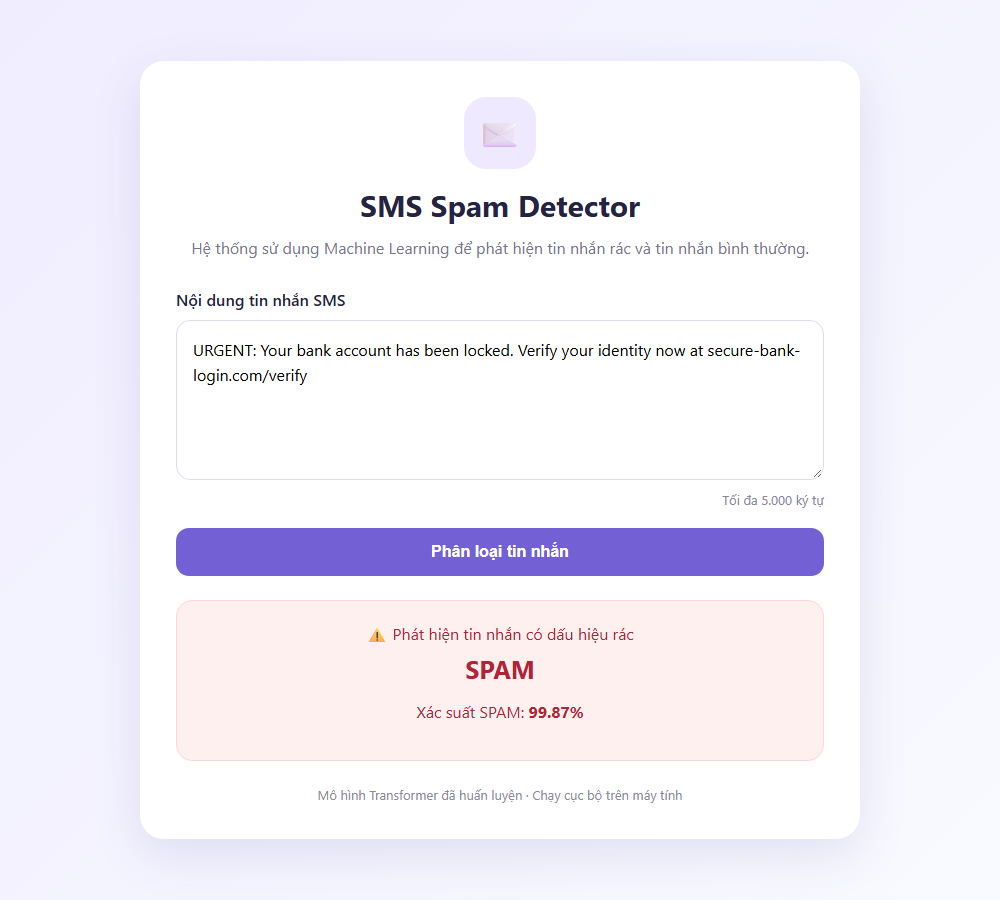
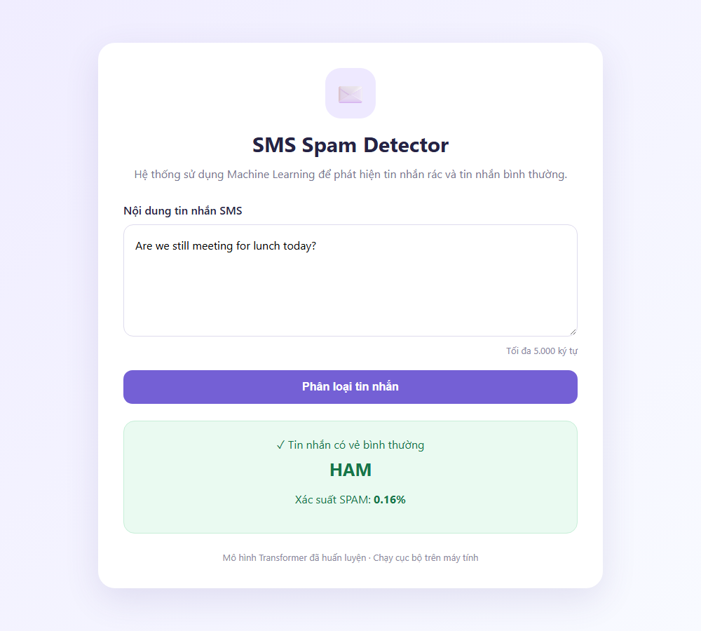

# CHƯƠNG 5 — WEBSITE DEMO PHÂN LOẠI SMS

## 5.1. Mục tiêu và phạm vi chức năng

Website minh họa việc sử dụng một mô hình đã huấn luyện để phân loại văn bản do người dùng nhập. Người dùng nhập SMS tiếng Anh, gửi biểu mẫu và nhận nhãn HAM/SPAM cùng điểm SPAM. Giao diện viết bằng tiếng Việt không làm thay đổi phạm vi ngôn ngữ của mô hình: dữ liệu học vẫn là SMS tiếng Anh.

Phiên bản hiện tại nạp Transformer baseline từ `models/transformer/demo_checkpoint`, bản sao của checkpoint `eval/results/baseline/transformer` được đánh giá ở Chương 4. Mô hình này được chọn vì có F1 SPAM cao nhất trên tập SMS thật ngoài nguồn (mục 4.7–4.8). MLP và BiLSTM thuộc phần đánh giá ngoại tuyến, không có bộ chọn trên website. Ứng dụng không phải bộ thu nhận SMS từ điện thoại và không tự chặn tin trong hệ thống viễn thông. Sản phẩm là demo cục bộ của luồng suy luận, được mô tả từ `app.py`, `templates/index.html` và `start_website.bat`.

## 5.2. Kiến trúc Flask, HTML và Jinja

Flask là framework web Python dùng để định tuyến yêu cầu và tạo phản hồi; Jinja là hệ thống template được Flask dùng để kết hợp dữ liệu Python với HTML [14], [15]. Trong ứng dụng, `app.py` tiếp nhận yêu cầu, gọi mô hình và truyền các biến tới `render_template("index.html", ...)`. HTML cung cấp biểu mẫu và vùng hiển thị; các điều kiện Jinja quyết định có xuất lỗi hoặc kết quả hay không.

**Bảng 5.1. Thành phần website và trách nhiệm theo mã.**

| Thành phần | Trách nhiệm |
|---|---|
| Trình duyệt và `templates/index.html` | Nhập SMS; gửi POST; hiển thị nội dung, lỗi, nhãn và điểm |
| Route `/` trong `app.py` | Phân biệt GET/POST, kiểm tra đầu vào, gọi phân loại |
| `classify_message` | Chuẩn hóa văn bản, mã hóa token ID, chạy mạng, sigmoid và gán nhãn |
| `data/prepare_data.py` | Hàm `normalize_text` dùng chung với bước tạo dữ liệu |
| `models/common.py` | Dựng/nạp mạng và chuyển văn bản thành tensor |
| `models/transformer/demo_checkpoint/config.json` | Kích thước mạng, vocabulary, `max_len` và ngưỡng |
| `models/transformer/demo_checkpoint/encoder.joblib` | Ánh xạ token → ID học trên train |
| `models/transformer/demo_checkpoint/model.pt` | Trọng số checkpoint Transformer |
| `start_website.bat` | Chuyển về thư mục dự án, tìm Python trong `eval\.venv` rồi `.venv`, mở URL và chạy `app.py` |

*Nguồn: `app.py`, `models/common.py`, `data/prepare_data.py`, `templates/index.html`, `start_website.bat` và artifact trong `models/transformer/demo_checkpoint`.*

Khi module `app.py` được nạp, chương trình đặt số luồng PyTorch là bốn và gọi `load_checkpoint("transformer", MODEL_DIR)` trước khi phục vụ route. Mô hình và encoder được nạp một lần ở giai đoạn khởi động, không huấn luyện lại cho mỗi yêu cầu. Nếu thiếu hoặc không nạp được artifact, mã hiện tại chưa có nhánh giao diện riêng để phục hồi lỗi khởi động.

## 5.3. Luồng GET/POST và kiểm tra đầu vào

Với GET `/`, hàm `home` khởi tạo nội dung rỗng, kết quả/điểm/lỗi là `None` và render trang nhập. Với POST, hàm lấy trường `message`, dùng giá trị rỗng nếu trường thiếu rồi gọi `.strip()`. Kiểm tra rỗng và độ dài diễn ra sau bước loại khoảng trắng hai đầu; chuỗi chỉ có khoảng trắng cũng rơi vào nhánh lỗi rỗng.

**Hình 5.1. Luồng xử lý website theo mã Flask hiện tại.**



*Nguồn: route `home` và hàm `classify_message` trong `app.py`; ngưỡng 0,5 từ config checkpoint demo. Các nhánh được kiểm thử ở mục 5.6.*

Biểu mẫu HTML dùng `method="POST"`, trường `textarea` có `name="message"`, `required` và `maxlength="5000"`. Kiểm tra phía trình duyệt hỗ trợ người dùng, còn kiểm tra phía Flask tiếp tục xử lý yêu cầu thiếu trường hoặc vượt giới hạn nếu gửi trực tiếp. Mã server dùng `len` trên chuỗi Python, không giới hạn theo số token. Giới hạn 5.000 ký tự của web khác giới hạn 100 token của mô hình: phần văn bản sau token thứ 100 không ảnh hưởng tới dự đoán.

Ở nhánh rỗng, thông báo là “Vui lòng nhập nội dung tin nhắn.”; ở nhánh quá dài là “Tin nhắn quá dài. Vui lòng nhập tối đa 5.000 ký tự.”. Khi lỗi đầu vào, hàm không gọi `classify_message`.

## 5.4. Suy luận và hiển thị kết quả

Đầu vào hợp lệ được chuẩn hóa bằng `normalize_text`, rồi truyền đến `transform_texts("transformer", encoder, [...], config["max_len"])`. Bộ mã hóa tách token, đổi sang ID theo vocabulary đã học (token chưa gặp nhận `<UNK>`), đệm hoặc cắt về 100 vị trí.

Mạng được gọi trong `torch.inference_mode()` sau `model.eval()`. Forward trả một logit, `torch.sigmoid(...).item()` lấy điểm SPAM vô hướng. Hàm đọc ngưỡng bằng `config.get("decision_threshold", 0.5)`; config đang lưu giá trị 0,5. Điểm lớn hơn hoặc bằng ngưỡng được gán SPAM, nhỏ hơn ngưỡng được gán HAM.

Template giữ lại SMS trong textarea bằng `{{ message }}`; hiển thị lỗi nếu có `error`, và hiển thị vùng kết quả nếu có `result`. CSS phân biệt SPAM bằng vùng màu đỏ và HAM bằng vùng màu xanh. Chân trang ghi “Mô hình Transformer đã huấn luyện”.

Giao diện ghi “Xác suất SPAM” và định dạng `probability * 100` bằng hai chữ số thập phân. Trong báo cáo, giá trị này được gọi là điểm sigmoid SPAM vì chưa có thí nghiệm hiệu chỉnh xác suất. Một điểm cao không bảo đảm cùng mức chính xác trên mọi nguồn SMS mới. Chuỗi định dạng dùng `%.2f`, nên giao diện hiển thị dấu chấm thập phân, khác quy ước dấu phẩy của văn bản báo cáo.

## 5.5. Đồng bộ tiền xử lý giữa huấn luyện và web

Phiên bản trước của website đưa chuỗi người dùng trực tiếp vào encoder mà không gọi `normalize_text`, trong khi mô hình học trên văn bản đã chữ thường hóa và thay URL/điện thoại/tiền bằng placeholder. Lỗi này đã được sửa: `app.py` và `test_model.py` cùng gọi `normalize_text` trước khi vector hóa. Vì toàn bộ cột `text` của các split đã được sinh lại bằng cùng hàm (mục 2.4), văn bản người dùng và văn bản huấn luyện giờ đi qua cùng một quy trình chuẩn hóa.

Điều này vẫn có một giới hạn: checkpoint chỉ đúng với phiên bản `normalize_text` dùng khi tạo dữ liệu train. Nếu sau này đổi hàm chuẩn hóa, cần sinh lại split và huấn luyện lại; mã hiện tại chưa ghi phiên bản hàm chuẩn hóa vào config để phát hiện sai lệch tự động.

## 5.6. Khởi chạy cục bộ và kết quả kiểm thử

Theo mã, ứng dụng đặt địa chỉ `127.0.0.1`, cổng 5000 và `debug=False`. `start_website.bat` tìm Python trong `eval\.venv` rồi `.venv`, mở trình duyệt tới `http://127.0.0.1:5000`, rồi chạy `app.py`. Tệp BAT mở trình duyệt trước khi server sẵn sàng, nên có thể cần tải lại trang sau vài giây. Lệnh khởi chạy trực tiếp là:

```powershell
.\eval\.venv\Scripts\python.exe app.py
```

Môi trường `eval\.venv` được tạo bằng `py -3.11 eval/setup_env.py` và cài thêm Flask 3.1.3. Thư mục `.venv` ở gốc dự án được tạo trên một máy khác và không chạy được trên máy kiểm thử.

**Bảng 5.2. Kết quả kiểm thử các nhánh của website.**

| Trường hợp | Mã HTTP | Kết quả quan sát |
|---|---:|---|
| GET `/` | 200 | Hiển thị biểu mẫu, không có lỗi hay kết quả |
| POST tin lừa đảo khóa tài khoản kèm liên kết | 200 | Nhãn SPAM, điểm 0,9592 |
| POST “Are we still meeting for lunch today?” | 200 | Nhãn HAM, điểm 0,0016 |
| POST chỉ có khoảng trắng | 200 | Thông báo yêu cầu nhập |
| POST thiếu trường `message` | 200 | Thông báo yêu cầu nhập |
| POST 5.001 ký tự | 200 | Thông báo quá dài |
| Server thật, POST tin trúng thưởng kèm liên kết | 200 | Nhãn SPAM, điểm hiển thị 99.92% |

*Nguồn: `ho-so-bien-tap/kiem-thu-website.py` và đầu ra `kiem-thu-website.json` (Flask test client); dòng cuối là lần khởi động `app.py` và gửi POST qua HTTP tới `127.0.0.1:5000` ngày 05/11/2026.*

**Hình 5.2. Giao diện website khi phân loại một tin lừa đảo khóa tài khoản.**



*Nguồn: HTML do `app.py` trả về cho POST, chụp bằng Microsoft Edge headless qua `ho-so-bien-tap/chup-giao-dien.py` ngày 05/11/2026. Điểm 99,87% khác 0,9592 ở Bảng 5.2 vì nội dung tin khác nhau.*

**Hình 5.3. Giao diện website khi phân loại một tin nhắn thông thường.**



*Nguồn: như Hình 5.2. Ảnh trang chủ chưa nhập nội dung lưu tại `hinh/website-trang-chu.png`.*

Kết quả xác nhận các nhánh xử lý chạy đúng trên một máy Windows. Khả năng chịu tải, xử lý đồng thời, ứng xử khi artifact lỗi và triển khai production chưa được kiểm thử.
