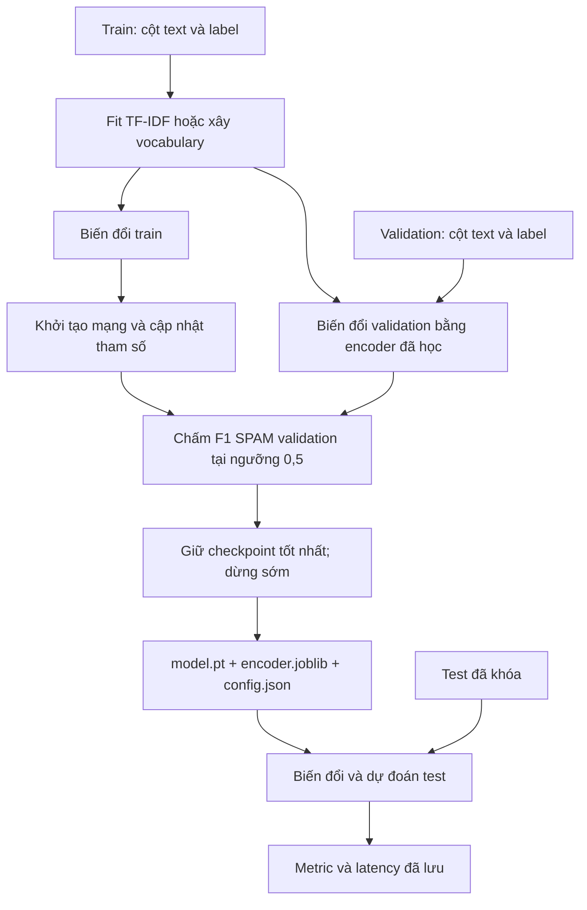
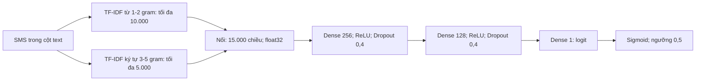
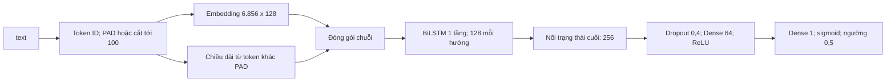
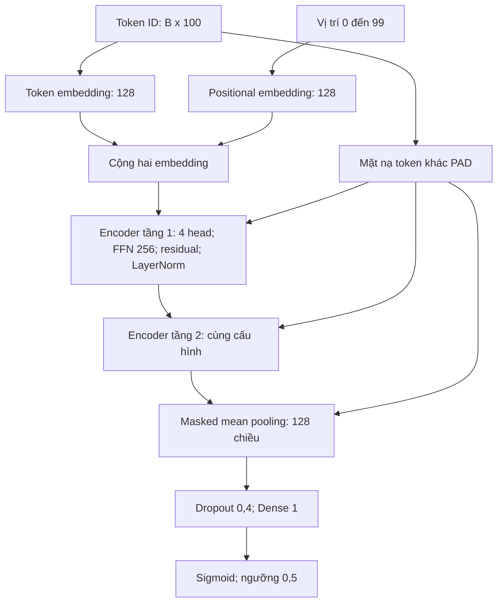
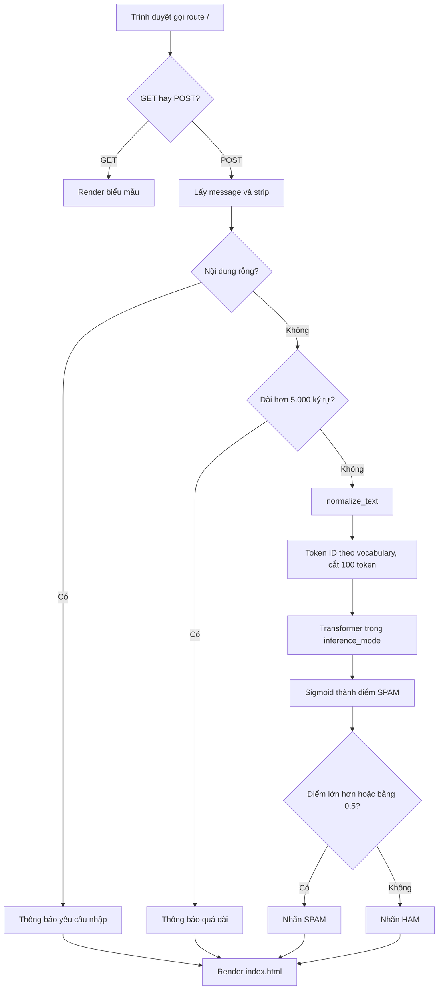
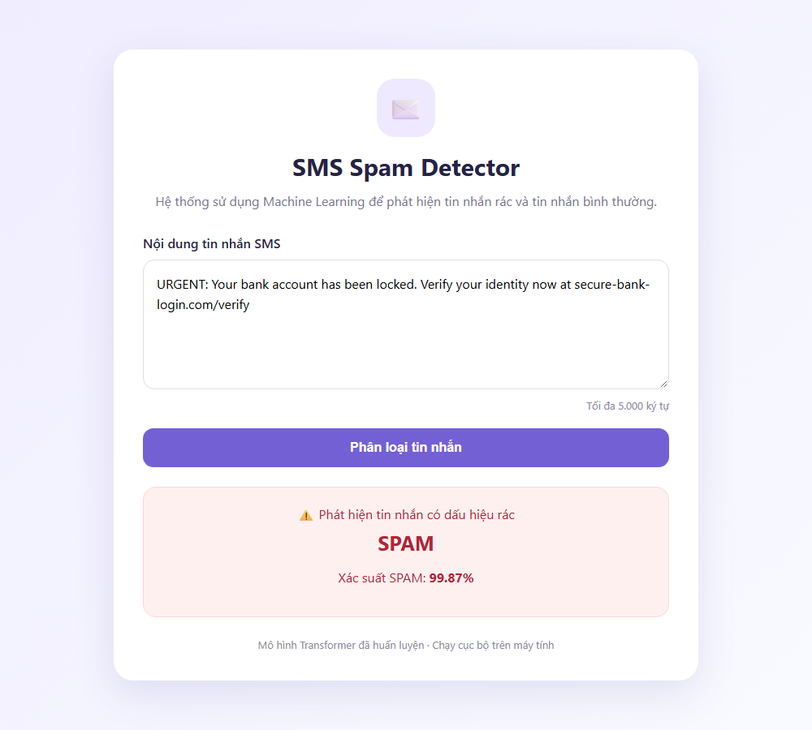

# Phát hiện tin nhắn SMS rác bằng mạng nơ-ron MLP, LSTM và Transformer

## Mục lục nội dung

- [MỞ ĐẦU](#mo-dau)
- [CHƯƠNG 1 — CƠ SỞ LÝ THUYẾT](#chuong-1)
- [CHƯƠNG 2 — DỮ LIỆU VÀ TIỀN XỬ LÝ](#chuong-2)
- [CHƯƠNG 3 — THIẾT KẾ MÔ HÌNH VÀ QUY TRÌNH HUẤN LUYỆN](#chuong-3)
- [CHƯƠNG 4 — KẾT QUẢ THỰC NGHIỆM VÀ SO SÁNH](#chuong-4)
- [CHƯƠNG 5 — WEBSITE DEMO PHÂN LOẠI SMS](#chuong-5)
- [KẾT LUẬN VÀ HƯỚNG PHÁT TRIỂN](#ket-luan)
- [TÀI LIỆU THAM KHẢO](#tai-lieu-tham-khao)
- [PHỤ LỤC](#phu-luc)

## Danh mục hình

- Hình 3.1. Luồng thực nghiệm chung và vai trò của ba tập dữ liệu.
- Hình 3.2. Kiến trúc MLP hiện tại.
- Hình 3.3. Kiến trúc BiLSTM và cách xử lý padding.
- Hình 3.4. Kiến trúc Transformer encoder và hai vai trò của mặt nạ.
- Hình 5.1. Luồng xử lý website theo mã Flask hiện tại.
- Hình 5.2. Giao diện website khi phân loại một tin lừa đảo khóa tài khoản.
- Hình 5.3. Giao diện website khi phân loại một tin nhắn thông thường.

## Danh mục bảng

- Bảng 1.1. Ý nghĩa các ô ma trận nhầm lẫn trong phân loại SMS.
- Bảng 2.1. Quy mô dữ liệu và phân bố hai lớp trong các CSV hiện lưu.
- Bảng 2.2. Các trường dữ liệu được sử dụng trong pipeline.
- Bảng 2.3. Các bước của hàm chuẩn hóa hiện tại và ý nghĩa.
- Bảng 2.4. Nội dung trùng giữa các tập theo từng cột hiện lưu.
- Bảng 2.5. Các tập dữ liệu bổ sung.
- Bảng 3.1. Đầu vào và cấu trúc ba phương án.
- Bảng 3.2. Cấu hình huấn luyện đã lưu và cơ chế theo mã hiện tại.
- Bảng 4.1. Điều kiện chung và giới hạn kiểm soát của phép so sánh.
- Bảng 4.2. Các chỉ số test của ba mô hình trên 836 SMS.
- Bảng 4.3. Ma trận nhầm lẫn MLP tại ngưỡng 0,5.
- Bảng 4.4. Ma trận nhầm lẫn BiLSTM tại ngưỡng 0,5.
- Bảng 4.5. Ma trận nhầm lẫn Transformer tại ngưỡng 0,5.
- Bảng 4.6. Số tham số, thời gian huấn luyện và latency.
- Bảng 4.7. F1 SPAM trên `test.csv` của lượt Colab và lượt huấn luyện lại.
- Bảng 4.8. F1 SPAM trước (baseline) và sau (augmented) khi bổ sung dữ liệu, trên ba tập test.
- Bảng 4.9. Ma trận nhầm lẫn của các mô hình baseline trên `test_external.csv`.
- Bảng 4.10. Kết quả trên 66 SMS tự soạn.
- Bảng 4.11. Kết luận được số liệu hỗ trợ cho từng mô hình.
- Bảng 5.1. Thành phần website và trách nhiệm theo mã.
- Bảng 5.2. Kết quả kiểm thử các nhánh của website.
- Bảng KL.1. Mức đáp ứng các mục tiêu nêu ở Mở đầu.
- Bảng PL.B.1. Toàn bộ các trường trong ba config baseline.
- Bảng PL.E.1. Các nhóm unit test của dự án.
- Bảng PL.E.2. Các kiểm tra khác đã thực hiện.

---

<a id="mo-dau"></a>

# MỞ ĐẦU

## MĐ.1. Bối cảnh và lý do chọn đề tài

Phân loại tin nhắn SMS là bài toán xác định một nội dung văn bản thuộc nhóm tin nhắn bình thường hay tin nhắn rác. Trong bài toán này, hệ thống cần nhận diện các dấu hiệu liên quan đến nội dung không mong muốn, đồng thời hạn chế việc đánh dấu nhầm những tin nhắn hợp lệ. Hai loại sai sót đều cần được xem xét: bỏ sót tin nhắn rác làm giảm khả năng lọc của hệ thống, còn phân loại nhầm tin nhắn bình thường thành tin nhắn rác có thể khiến người dùng bỏ qua thông tin cần thiết. Vì vậy, đánh giá một bộ phân loại SMS cần quan tâm đến cách mô hình xử lý từng lớp, bên cạnh tỷ lệ dự đoán đúng trên toàn bộ dữ liệu.

Đối với đồ án học máy và học sâu, bài toán này cho phép khảo sát đầy đủ quá trình xây dựng một hệ thống phân loại văn bản: xác định nhãn, tổ chức dữ liệu, biểu diễn nội dung bằng các giá trị số, huấn luyện mô hình, đánh giá kết quả và tích hợp mô hình vào ứng dụng. Bộ dữ liệu SMS Spam Collection đang có trong dự án gồm các tin nhắn tiếng Anh được gán nhãn HAM hoặc SPAM, tạo cơ sở cho việc thực hiện và đối chiếu các bước trên trong một phạm vi cụ thể.

Đề tài lựa chọn ba kiến trúc MLP (mạng perceptron nhiều lớp), LSTM (mạng bộ nhớ dài–ngắn hạn) và Transformer để khảo sát những cách xử lý đầu vào khác nhau. Trong triển khai của đồ án, MLP tiếp nhận đặc trưng TF-IDF kết hợp từ các cụm từ và chuỗi ký tự, gọi chung là n-gram. LSTM hai chiều tiếp nhận chuỗi mã token, tức các đơn vị văn bản sau khi tách, và sử dụng lớp embedding để ánh xạ các mã này thành vector học từ đầu. Transformer encoder cũng xử lý chuỗi token, kết hợp thông tin vị trí và cơ chế attention để tính toán quan hệ giữa các token. So sánh ba cách tiếp cận này giúp làm rõ mối liên hệ giữa biểu diễn đầu vào, kiến trúc mô hình và kết quả phân loại trong điều kiện thực nghiệm của dự án.

Một yêu cầu của phép so sánh là các mô hình sử dụng cùng bộ chia dữ liệu và cùng quy tắc đánh giá. Tuy nhiên, đầu vào TF-IDF của MLP khác với đầu vào chuỗi token của hai mô hình còn lại. Do đó, kết quả phản ánh sự kết hợp giữa cách biểu diễn văn bản và kiến trúc, không cho phép quy toàn bộ chênh lệch chỉ cho một thành phần riêng lẻ. Cách đặt vấn đề này phù hợp với mục tiêu của đồ án: giải thích phương pháp, đối chiếu kết quả có căn cứ và nhận diện giới hạn của thực nghiệm.

Từ những lý do trên, đề tài **“Phát hiện tin nhắn SMS rác bằng mạng nơ-ron MLP, LSTM và Transformer”** được thực hiện với hai nội dung gắn kết: xây dựng và so sánh các mô hình phân loại trong thực nghiệm, đồng thời minh họa cách sử dụng mô hình đã huấn luyện qua một website. Website hiện sử dụng Transformer, mô hình tổng quát tốt nhất trên dữ liệu ngoài nguồn; MLP và LSTM phục vụ phần so sánh thực nghiệm. Việc tách rõ hai phạm vi này giúp xác định đúng chức năng của sản phẩm và ý nghĩa của các kết quả được trình bày.

## MĐ.2. Phát biểu bài toán

Đầu vào của hệ thống là nội dung một tin nhắn SMS tiếng Anh. Đầu ra là một trong hai nhãn: **HAM**, biểu thị tin nhắn bình thường, hoặc **SPAM**, biểu thị tin nhắn rác. Trong quá trình tính các chỉ số đánh giá, SPAM được quy ước là lớp dương, tương ứng nhãn số 1; HAM là lớp âm, tương ứng nhãn số 0.

Sau bước biểu diễn văn bản phù hợp với từng kiến trúc, mô hình tạo ra một điểm số thô gọi là logit. Hàm sigmoid chuyển giá trị này thành điểm dự đoán SPAM trong khoảng từ 0 đến 1. Hệ thống quyết định nhãn SPAM khi điểm dự đoán lớn hơn hoặc bằng 0,5; các trường hợp còn lại được gán nhãn HAM. Điểm dự đoán thể hiện đầu ra của mô hình, không tự nó bảo đảm mức độ chính xác của dự đoán đối với một tin nhắn mới.

Ngưỡng 0,5 được sử dụng thống nhất cho cả ba mô hình khi chọn bản lưu trọng số (checkpoint) trên tập validation và khi đánh giá trên tập test. Đây là ngưỡng cố định của phép so sánh, không phải ngưỡng được tối ưu F1 riêng cho từng mô hình. Bài toán của đồ án bao gồm việc đánh giá khả năng phân loại tại ngưỡng này và khả năng xếp hạng mẫu thông qua ROC-AUC, đồng thời xem xét chi phí tính toán đã được ghi nhận.

## MĐ.3. Mục tiêu của đề tài

Mục tiêu tổng quát là xây dựng hệ thống phân loại SMS tiếng Anh thành HAM hoặc SPAM, khảo sát ba kiến trúc mạng nơ-ron được huấn luyện từ đầu và trình bày kết quả so sánh trong phạm vi dữ liệu thực nghiệm hiện có. Transformer trong đề tài là một encoder nhỏ được tự xây dựng, không sử dụng checkpoint BERT hoặc trọng số pretrained.

Các mục tiêu cụ thể gồm:

1. **Mô tả và tổ chức dữ liệu cho bài toán phân loại.** Trình bày đặc điểm bộ dữ liệu, phân bố nhãn, các tập train/validation/test và vai trò của từng tập; làm rõ biểu diễn đầu vào của các mô hình.
2. **Xây dựng ba phương án phân loại.** Triển khai MLP trên đặc trưng TF-IDF, LSTM hai chiều trên chuỗi token và Transformer encoder học từ đầu; giải thích nguyên lý hoạt động và các thành phần chính của từng phương án.
3. **Thực hiện phép so sánh theo quy trình chung.** Sử dụng cùng các tập dữ liệu đã lưu, chọn checkpoint theo F1 của lớp SPAM trên validation và áp dụng ngưỡng quyết định 0,5 thống nhất.
4. **Phân tích kết quả và giới hạn của thực nghiệm.** Đối chiếu Accuracy, Precision, Recall, F1-score, ROC-AUC, ma trận nhầm lẫn, độ trễ, số tham số và thời gian huấn luyện; kiểm tra thêm trên dữ liệu ngoài nguồn và diễn giải những yếu tố ảnh hưởng đến độ tin cậy của kết luận.
5. **Minh họa việc sử dụng mô hình trong ứng dụng.** Mô tả website Python Flask cho phép nhập tin nhắn và xem nhãn phân loại cùng điểm SPAM do Transformer đã huấn luyện cung cấp.

## MĐ.4. Đối tượng, phạm vi, phương pháp và sản phẩm của đồ án

### MĐ.4.1. Đối tượng và phạm vi dữ liệu

Đối tượng nghiên cứu là phương pháp biểu diễn và phân loại nội dung SMS bằng MLP, LSTM và Transformer. Dữ liệu của đồ án là SMS Spam Collection, gồm **5.572 tin nhắn**, trong đó có **4.825 tin HAM** và **747 tin SPAM**. Số lượng hai lớp không cân bằng, vì vậy việc nhận xét kết quả cần xem riêng khả năng phát hiện SPAM và mức độ phân loại nhầm HAM.

Dữ liệu hiện có được chia theo tỷ lệ mục tiêu 70% cho huấn luyện, 15% cho validation và 15% cho test, với giá trị khởi tạo ngẫu nhiên (random seed) 42 theo hồ sơ dự án. Số lượng thực tế tương ứng là **3.900, 836 và 836 tin nhắn**. Cả ba mô hình sử dụng cùng các tập này. Tập train được dùng để học tham số và xây dựng bộ biểu diễn đầu vào; validation phục vụ theo dõi và chọn checkpoint; test được dành cho việc đánh giá sau khi chọn checkpoint.

Việc kiểm tra dữ liệu ghi nhận **84 dòng trong tập test có nội dung trùng với tập train**, khi so khớp chính xác văn bản đang được dùng làm đầu vào mô hình. Đây là một hạn chế có thể ảnh hưởng đến độ tin cậy của kết quả đánh giá: mức độ độc lập giữa train và test bị giảm, nên kết quả có thể lạc quan hơn so với khi đánh giá trên các tin nhắn hoàn toàn mới. Để bù một phần, đồ án đánh giá thêm trên 387 SMS thật từ một nguồn khác, đã loại mọi tin trùng hoặc gần trùng với dữ liệu UCI.

Phạm vi nội dung giới hạn ở phân loại nhị phân SMS tiếng Anh. Ngoài SMS Spam Collection, đồ án dùng hai bộ dữ liệu bổ sung: một bộ SMS lừa đảo tổng hợp để thử nghiệm bổ sung dữ liệu huấn luyện, và một bộ SMS thật để đánh giá ngoài nguồn. Kết quả chưa đủ để khẳng định khả năng nhận diện SMS tiếng Việt hoặc tin nhắn lừa đảo hiện nay. Các mô hình được so sánh là ba kiến trúc học từ đầu; các mô hình pretrained và phương án cascade không thuộc bảng kết quả của đồ án.

### MĐ.4.2. Phương pháp thực hiện và đánh giá

Đồ án sử dụng phương pháp thực nghiệm so sánh, kết hợp giải thích mô hình từ mã nguồn với phân tích cấu hình và kết quả. Ba mô hình lần đầu được huấn luyện trên Google Colab; kết quả chính trong báo cáo đến từ lượt huấn luyện lại cục bộ trên CPU bằng mã hiện tại, có ghi lại phần cứng và phiên bản thư viện. Lượt Colab được giữ để đối chiếu.

Về biểu diễn văn bản, MLP sử dụng đặc trưng TF-IDF từ và ký tự, còn LSTM và Transformer sử dụng mã token từ bộ từ vựng xây dựng trên train. Theo triển khai hiện có, việc học bộ TF-IDF và xây dựng từ vựng chỉ sử dụng tập train; validation và test được biến đổi bằng bộ biểu diễn tương ứng. Cần phân biệt bước chuẩn hóa văn bản với bước chuyển văn bản thành đặc trưng, bởi ba mô hình có cách biểu diễn đầu vào khác nhau.

Cột văn bản của mọi tập đã được sinh lại bằng hàm chuẩn hóa hiện tại, nên dữ liệu huấn luyện, đánh giá và website đi qua cùng một quy trình. Thành viên các tập được giữ nguyên; phương án chia dữ liệu theo nhóm văn bản đã có trong mã nhưng chưa được áp dụng.

Việc đánh giá sử dụng nhiều chỉ số để phản ánh các khía cạnh khác nhau của bộ phân loại. **Accuracy** là tỷ lệ dự đoán đúng trên toàn bộ mẫu. Với SPAM là lớp dương, **Precision** cho biết trong các tin bị mô hình gán nhãn SPAM, bao nhiêu tin thực sự là SPAM; **Recall** cho biết mô hình phát hiện được bao nhiêu trong tổng số tin SPAM thực tế. **F1-score** là trung bình điều hòa của Precision và Recall, giúp xem xét đồng thời hai đại lượng này. Các chỉ số trên được tính tại ngưỡng quyết định 0,5.

**ROC-AUC** phản ánh khả năng xếp hạng mẫu SPAM cao hơn mẫu HAM thông qua diện tích dưới đường ROC khi thay đổi ngưỡng. Chỉ số này không đồng nghĩa với Accuracy tại ngưỡng 0,5. **Ma trận nhầm lẫn** làm rõ số tin HAM được nhận diện đúng, HAM bị gán nhầm SPAM, SPAM bị bỏ sót và SPAM được nhận diện đúng. Trong báo cáo, hàng của ma trận là nhãn thật, cột là nhãn dự đoán và thứ tự nhãn là HAM rồi SPAM. Cách kết hợp các chỉ số giúp tránh đánh giá hệ thống chỉ từ một con số tổng hợp.

Bên cạnh chất lượng phân loại, báo cáo đối chiếu số tham số, thời gian huấn luyện và độ trễ xử lý. Phép đo độ trễ bao gồm bước vector hóa và suy luận trên CPU, được biểu diễn theo thời gian trung bình cho mỗi tin nhắn ở các kích thước lô xử lý (batch) tương ứng. Các số đo thực hiện trên một máy cụ thể, một lần đo, nên chưa đủ để suy rộng sang môi trường triển khai khác.

### MĐ.4.3. Sản phẩm và giới hạn triển khai

Các sản phẩm của đồ án gồm mã nguồn cho ba phương án phân loại, bộ biến đổi đầu vào và checkpoint đã lưu, kết quả đánh giá trên tập test hiện có và website minh họa. Báo cáo trình bày những sản phẩm này trong cùng một quy trình để người đọc theo dõi từ dữ liệu đến kết quả phân loại.

Website được xây dựng bằng Python Flask, tiếp nhận nội dung do người dùng nhập và sử dụng **mô hình Transformer** để trả về nhãn HAM hoặc SPAM cùng điểm dự đoán SPAM. MLP và LSTM được dùng trong phần so sánh thực nghiệm, chưa được tích hợp thành lựa chọn mô hình trên website. Phạm vi sản phẩm là một ứng dụng minh họa chạy cục bộ; các nhánh xử lý đã được kiểm thử trên một máy, chưa kiểm thử chịu tải.

Các hướng như chia lại dữ liệu để loại trùng lặp giữa các tập, thu thập thêm SMS lừa đảo thật và hiện đại, và khảo sát nhiều seed là các đề xuất hoàn thiện tiếp theo, chưa được xem là thí nghiệm đã hoàn thành.

## MĐ.5. Bố cục báo cáo

Ngoài phần Mở đầu và Kết luận, báo cáo được tổ chức thành năm chương:

- **Chương 1 — Cơ sở lý thuyết:** Trình bày phân loại văn bản, biểu diễn dữ liệu, nguyên lý của MLP/LSTM/Transformer, phương pháp huấn luyện và các chỉ số đánh giá.
- **Chương 2 — Dữ liệu và tiền xử lý:** Giới thiệu SMS Spam Collection và hai bộ dữ liệu bổ sung, phân bố lớp, bộ chia dữ liệu, biểu diễn văn bản và hạn chế do trùng nội dung giữa các tập.
- **Chương 3 — Thiết kế mô hình và quy trình huấn luyện:** Mô tả kiến trúc, cấu hình thực nghiệm, hàm mất mát, tối ưu hóa, lựa chọn checkpoint và quy trình đánh giá chung.
- **Chương 4 — Kết quả thực nghiệm và so sánh:** Trình bày các chỉ số, ma trận nhầm lẫn, chi phí tính toán, kết quả trên dữ liệu ngoài nguồn và thí nghiệm bổ sung dữ liệu.
- **Chương 5 — Website demo phân loại SMS:** Mô tả chức năng, luồng xử lý, cách tích hợp Transformer vào ứng dụng Flask và kết quả kiểm thử.

Phần **Kết luận** tổng hợp mức độ đáp ứng mục tiêu, các hạn chế của đồ án và hướng phát triển dựa trên những nội dung đã trình bày.

---

<a id="chuong-1"></a>

# CHƯƠNG 1 — CƠ SỞ LÝ THUYẾT

## 1.1. Phân loại văn bản và đặc điểm bài toán SMS

Phân loại văn bản là ánh xạ nội dung dạng chuỗi sang một hoặc nhiều nhãn định trước. Trong phân loại nhị phân của đồ án, mỗi SMS có nhãn thật $y\in\{0,1\}$, với 0 là HAM và 1 là SPAM. Gọi $s$ là văn bản, $\phi(s)$ là phép biểu diễn số và $f_\theta$ là mạng có tập tham số $\theta$. Mô hình tính logit $z=f_\theta(\phi(s))$, sau đó chuyển sang điểm SPAM bằng sigmoid. Như vậy, hệ thống được xác định bởi cả cách biểu diễn và mạng phân loại; cùng một kiến trúc nhưng khác bộ đặc trưng có thể cho hành vi khác nhau.

SMS thường chứa cách viết tắt, dấu câu và các chuỗi như số điện thoại hoặc địa chỉ web. Bộ phân loại cần học sự liên hệ giữa những dấu hiệu đó và nhãn trong dữ liệu, thay vì áp dụng quy tắc rằng mọi tin chứa URL đều là SPAM. Biểu diễn từ/ký tự và biểu diễn chuỗi token giữ những loại thông tin khác nhau, tạo cơ sở cho ba phương án được so sánh. Các nguyên lý phân loại văn bản và mô hình không gian vector được trình bày trong tài liệu của Manning và cộng sự [2].

Mất cân bằng lớp (class imbalance) xảy ra khi hai lớp có số mẫu khác nhau đáng kể. Nếu chỉ dự đoán lớp phổ biến, mô hình có thể có Accuracy tương đối cao mà không phát hiện được lớp ít mẫu. Với SMS, bỏ sót SPAM và chặn nhầm HAM cũng tạo ra hai hậu quả khác nhau. Vì vậy, đồ án dùng SPAM làm lớp dương và xem xét đồng thời Precision, Recall, F1 cùng ma trận nhầm lẫn, thay vì chỉ dùng Accuracy.

## 1.2. Chuẩn hóa, token, n-gram và TF-IDF

### 1.2.1. Chuẩn hóa và đơn vị văn bản

Chuẩn hóa văn bản đưa các biến thể hình thức về dạng thống nhất trước khi học. Các thao tác có thể gồm chuẩn hóa Unicode, chuyển chữ thường, gom khoảng trắng và thay chuỗi có cùng vai trò bằng ký hiệu đại diện. Chẳng hạn, placeholder `<URL>` giúp mô hình nhận biết sự xuất hiện của địa chỉ web mà không cần học riêng từng địa chỉ. Đây là phép biến đổi theo quy tắc, khác với học trọng số của mô hình. Quy trình hiện tại và giới hạn lịch sử của dữ liệu dự án được phân biệt ở Chương 2.

Token là đơn vị được bộ tách văn bản nhận diện; token có thể là từ, placeholder hoặc dấu câu. Từ vựng (vocabulary) là tập token có mã định danh. Token không đồng nghĩa hoàn toàn với từ trong ngôn ngữ: mã hiện tại có thể coi `!` là một token riêng. N-gram là một dãy liên tiếp gồm $n$ đơn vị. Word unigram giữ từng token, word bigram giữ cặp token liền nhau; character n-gram giữ các đoạn ký tự liên tiếp, có thể chứa khoảng trắng và dấu câu.

Đặc trưng từ thuận lợi cho việc học các dấu hiệu từ vựng và cụm ngắn. Đặc trưng ký tự cung cấp thông tin về cấu tạo chuỗi, hỗ trợ biểu diễn những biến thể không trùng hẳn một từ đã gặp. Tuy nhiên, hai loại này không giữ toàn bộ thứ tự của SMS: vector cho biết sự xuất hiện và trọng số của các n-gram đã chọn, không biểu diễn đầy đủ quan hệ xa giữa mọi token. Đây là đánh đổi của phương pháp không gian vector [2], [3].

### 1.2.2. Trọng số TF-IDF

TF-IDF viết tắt của *term frequency–inverse document frequency*, tức tần suất thuật ngữ kết hợp nghịch đảo tần suất tài liệu. Với thuật ngữ hoặc n-gram $t$, văn bản $d$, số văn bản train $N$ và số văn bản train chứa $t$ là $df(t)$, dạng có làm trơn mà `TfidfVectorizer` sử dụng theo mặc định là:

$$
idf(t)=\log\frac{1+N}{1+df(t)}+1,\qquad
u_{t,d}=tf(t,d)\,idf(t). \tag{1.1}
$$

Ở đây $tf(t,d)$ là số lần $t$ xuất hiện trong $d$ khi không bật biến đổi tần suất logarit; $u_{t,d}$ là trọng số trước chuẩn hóa vector. IDF làm giảm ảnh hưởng tương đối của những đặc trưng xuất hiện phổ biến trên nhiều tài liệu. Cộng 1 trong tử và mẫu tránh phép chia không xác định và là một lựa chọn triển khai cụ thể, không phải công thức duy nhất của TF-IDF [3].

Với chuẩn hóa L2, vector đầu ra của một nhánh là $x_d=u_d/\sqrt{\sum_t u_{t,d}^{2}}$ nếu mẫu có đặc trưng khác 0. Nhánh từ và nhánh ký tự trong dự án được tính riêng rồi nối bằng `FeatureUnion`. Do đó, không nên diễn giải vector ghép như thể chỉ có một phép chuẩn hóa L2 chung sau khi nối. Từ vựng đặc trưng, lựa chọn đặc trưng và IDF đều phải được học trên train; test chỉ được biến đổi bằng bộ đã học để tránh sử dụng trước thông tin của tập đánh giá.

## 1.3. Chuỗi token ID và embedding

Trong biểu diễn chuỗi, mỗi token được thay bằng số nguyên trong từ vựng. ID chỉ là chỉ số tra cứu, không có ý nghĩa số học như “token 8 lớn gấp đôi token 4”. Lớp embedding có ma trận $E\in\mathbb{R}^{V\times d_e}$, trong đó $V$ là kích thước từ vựng và $d_e$ là số chiều embedding. Token ID $k$ được ánh xạ thành hàng $E_k$. Những vector này được cập nhật bằng gradient trong huấn luyện, không lấy từ một mô hình ngôn ngữ pretrained.

Các SMS có số token khác nhau nên cần thống nhất kích thước tensor. Padding bổ sung mã `<PAD>` vào cuối chuỗi ngắn; truncation cắt chuỗi dài tới giới hạn $L$. Token chưa có trong từ vựng được ánh xạ sang `<UNK>`. Dự án dùng `<PAD>=0`, `<UNK>=1` và $L=100$. Nếu SMS bị cắt, mô hình chỉ nhận phần đầu 100 token; báo cáo không có thống kê tỷ lệ bị cắt vì hồ sơ thực nghiệm chưa lưu đại lượng này.

Padding là phần kỹ thuật, không phải nội dung SMS. Vì thế, BiLSTM cần chiều dài thật khi đóng gói chuỗi; Transformer cần mặt nạ padding và loại vị trí đệm khỏi pooling. Nếu bỏ qua điều này, phần bổ sung nhằm đồng nhất kích thước có thể làm thay đổi biểu diễn câu. Chi tiết hai cơ chế được trình bày ở Chương 3.

## 1.4. Mạng nơ-ron, MLP và lan truyền ngược

### 1.4.1. Logit, sigmoid và quyết định nhãn

Một lớp kết nối đầy đủ (fully connected, Dense) tính $a=Wx+b$, với vector đầu vào $x$, ma trận trọng số $W$ và vector độ lệch $b$. Ghép các lớp cùng hàm phi tuyến tạo thành mạng perceptron nhiều lớp (*multilayer perceptron*, MLP). Nếu chỉ ghép các phép biến đổi tuyến tính mà không có phi tuyến, toàn mạng vẫn tương đương một phép biến đổi affine, làm giảm khả năng mô tả tương tác phức tạp giữa đặc trưng.

Đồ án dùng hàm ReLU $\operatorname{ReLU}(a)=\max(0,a)$ theo từng thành phần và một đầu ra vô hướng $z$, gọi là logit. Hàm sigmoid và quy tắc phân loại là:

$$
p=\sigma(z)=\frac{1}{1+e^{-z}},\qquad
\widehat y=\begin{cases}1,&p\geq\tau,\\0,&p<\tau,\end{cases}\quad\tau=0{,}5. \tag{1.2}
$$

$p$ là điểm SPAM; $\widehat y$ là nhãn dự đoán. Với logit hữu hạn $z\in\mathbb R$, sigmoid toán học cho $0<p<1$ và ngưỡng $\tau=0{,}5$ tương ứng quy tắc dự đoán SPAM khi $z\geq0$. Trong tính toán số thực dấu phẩy động, điểm có thể làm tròn thành 0 hoặc 1. Điểm nằm trong $[0,1]$ không tự chứng minh rằng nó đã được hiệu chỉnh xác suất (*probability calibration*). Đặc biệt, loss có trọng số thay đổi cách mô hình trả giá cho lỗi lớp dương; cần đánh giá hiệu chỉnh riêng trước khi diễn giải điểm như tần suất đúng thực tế.

### 1.4.2. Dropout và cập nhật tham số

Dropout ngẫu nhiên loại một phần hoạt hóa trong lúc huấn luyện để hạn chế việc mạng phụ thuộc quá mức vào một số đường truyền. Theo cơ chế dropout chuẩn của PyTorch, các phần tử còn lại được điều chỉnh tỷ lệ trong train; khi gọi `eval()`, thao tác ngẫu nhiên này được tắt. Vì vậy, suy luận phải đặt mô hình vào chế độ đánh giá, bên cạnh việc tắt tính gradient. Trong MLP của dự án, tỷ lệ dropout là $0{,}4$ ở mỗi lớp ẩn; đây là xác suất loại hoạt hóa, không phải tỷ lệ loại mẫu dữ liệu.

Lan truyền ngược (*backpropagation*) dùng quy tắc đạo hàm hàm hợp để tính $\nabla_\theta\mathcal L$ từ loss đầu ra về các lớp trước. Với cập nhật gradient cơ bản, $\theta\leftarrow\theta-\eta\nabla_\theta\mathcal L$, trong đó $\eta$ là learning rate. Adam và AdamW trong dự án thay quy tắc này bằng cập nhật thích nghi dựa trên thống kê gradient; nguyên lý tính gradient vẫn là lan truyền ngược. Bài báo của Rumelhart, Hinton và Williams là tài liệu nền tảng về học biểu diễn bằng cơ chế này [4].

## 1.5. LSTM và LSTM hai chiều

LSTM (*long short-term memory*, mạng bộ nhớ dài–ngắn hạn) là một dạng mạng hồi tiếp có trạng thái ô nhớ để kiểm soát thông tin được giữ và cập nhật qua chuỗi. Công trình của Hochreiter và Schmidhuber giới thiệu nền tảng LSTM [5]. Các phương trình dưới đây mô tả biến thể có cổng quên theo API `nn.LSTM` đang được dự án sử dụng [6]; không đồng nhất từng chi tiết với mọi biến thể trong bài báo ban đầu.

Với vector đầu vào tại bước $t$ là $x_t$, trạng thái ẩn trước đó $h_{t-1}$ và ô nhớ trước đó $c_{t-1}$:

$$
\begin{aligned}
i_t&=\sigma(W_i x_t+U_i h_{t-1}+b_i),\\
f_t&=\sigma(W_f x_t+U_f h_{t-1}+b_f),\\
g_t&=\tanh(W_g x_t+U_g h_{t-1}+b_g),\\
o_t&=\sigma(W_o x_t+U_o h_{t-1}+b_o),\\
c_t&=f_t\odot c_{t-1}+i_t\odot g_t,\\
h_t&=o_t\odot\tanh(c_t).
\end{aligned} \tag{1.3}
$$

Các $W$ biến đổi đầu vào, $U$ biến đổi trạng thái ẩn, $b$ là bias gộp để viết gọn, $\odot$ là phép nhân từng phần tử và $\tanh$ là tang hyperbolic. Cổng đầu vào $i_t$ điều tiết nội dung mới; cổng quên $f_t$ điều tiết phần ô nhớ cũ được giữ; $g_t$ là nội dung ứng viên; cổng đầu ra $o_t$ điều tiết phần ô nhớ được biểu hiện trong trạng thái ẩn. Đường cập nhật cộng của $c_t$ hỗ trợ truyền thông tin và gradient qua nhiều bước, nhưng không bảo đảm loại bỏ mọi khó khăn khi học chuỗi.

LSTM một chiều đọc SMS từ trái sang phải. LSTM hai chiều (*bidirectional LSTM*, BiLSTM) có thêm một nhánh đọc theo chiều ngược. Hai nhánh có tham số riêng, cho phép biểu diễn toàn câu kết hợp ngữ cảnh từ hai hướng. Vì SMS được nhập đầy đủ trước khi phân loại, việc đọc hai chiều phù hợp với luồng xử lý của đồ án.

Mã dự án không lấy trung bình toàn bộ trạng thái LSTM. Mạng nối trạng thái ẩn cuối của hai hướng thành vector 256 chiều, sau đó đưa qua đầu phân loại. Với hidden size 128 mỗi hướng, con số 256 là chiều vector ghép, không phải hidden size của một hướng. `pack_padded_sequence` dùng chiều dài thật để loại phần đệm khỏi quá trình hồi tiếp, tránh nhầm trạng thái tại token cuối với trạng thái sau một chuỗi PAD.

## 1.6. Transformer encoder nhỏ

### 1.6.1. Embedding token và vị trí

Transformer dùng attention để trao đổi thông tin giữa các vị trí trong chuỗi. Cơ sở kiến trúc được trình bày trong *Attention Is All You Need* [7]. Dự án chỉ dùng phần encoder, không có decoder sinh văn bản. Token embedding và positional embedding đều được học từ đầu:

$$
X_t=E_{k_t}+P_t,\quad t=0,\ldots,L-1. \tag{1.4}
$$

$k_t$ là token ID tại vị trí $t$, $E_{k_t}\in\mathbb R^{128}$ và $P_t\in\mathbb R^{128}$ là vector vị trí. Attention thuần không tự biết thứ tự; cộng $P_t$ cung cấp thông tin này. Mã hiện tại dùng bảng vị trí học được, không dùng công thức vị trí sin/cos và không nhân token embedding với $\sqrt{d_{\mathrm{model}}}$ trước phép cộng.

### 1.6.2. Scaled dot-product attention và nhiều đầu

Từ đầu vào $X$, mỗi đầu attention tạo truy vấn (*query*) $Q=XW_Q$, khóa (*key*) $K=XW_K$ và giá trị (*value*) $V=XW_V$. Các ma trận $W_Q$, $W_K$, $W_V$ là trọng số chiếu học được; $V$ trong công thức attention là ma trận value, khác ký hiệu kích thước từ vựng ở Mục 1.3. Cơ chế attention tích vô hướng có điều chỉnh tỷ lệ là:

$$
\operatorname{Attention}(Q,K,V)=\operatorname{softmax}\!\left(\frac{QK^\top}{\sqrt{d_k}}+M\right)V. \tag{1.5}
$$

$X\in\mathbb R^{L\times d_{\mathrm{model}}}$ gồm $L$ vector token của một SMS; $Q,K\in\mathbb R^{L\times d_k}$, $V\in\mathbb R^{L\times d_v}$ và $M\in\mathbb R^{L\times L}$. Ở đây $d_k$ là số chiều key/query và $d_v$ là số chiều value của một đầu. Softmax áp dụng theo các vị trí key cho từng query; $M$ là mặt nạ cộng: 0 ở vị trí được phép chú ý, giá trị âm vô cùng ở key PAD. Mỗi query phải còn ít nhất một key không bị che để softmax được xác định, tức SMS phải có ít nhất một token khác PAD. Bộ mã hóa của dự án dùng `<UNK>` khi không tách được token; đây là cách xử lý trường hợp tách token rỗng. Công thức chiếu $Q,K,V$ viết gọn, không hiển thị các bias mà lớp thư viện có thể dùng.

Chia cho $\sqrt{d_k}$ kiểm soát độ lớn của tích vô hướng trước softmax. Sau khi nhân với $V$, đầu ra một đầu có dạng $L\times d_v$; mỗi hàng trọng số attention quyết định mức đóng góp của các vector value vào biểu diễn mới của một token.

Attention nhiều đầu (*multi-head attention*) thực hiện nhiều phép biến đổi $Q,K,V$, nối kết quả và chiếu lại bằng ma trận trọng số học được $W_O$. Trong dự án, $d_{\mathrm{model}}=128$, số đầu là 4 nên $d_k=d_v=32$ cho mỗi đầu. Các đầu cho phép học các quan hệ khác nhau, nhưng chưa có phân tích trọng số attention để gán một chức năng ngữ nghĩa cụ thể cho từng đầu. Encoder không dùng causal mask; token nội dung có thể chú ý tới các token nội dung ở cả hai phía.

### 1.6.3. Feed-forward, residual, LayerNorm và pooling

Mạng truyền thẳng theo vị trí (*position-wise feed-forward network*, FFN) biến đổi từng vector token bằng cùng bộ trọng số:

$$
\operatorname{FFN}(H)=\operatorname{ReLU}(HW_1+b_1)W_2+b_2. \tag{1.6}
$$

Trong Công thức (1.6), $H$ là các vector đầu vào, $W_1,W_2$ là ma trận trọng số, $b_1,b_2$ là bias của hai phép chiếu. Trong dự án, FFN có kích thước $128\rightarrow256\rightarrow128$. Mỗi encoder kết hợp attention và FFN với kết nối dư (*residual connection*), tức cộng đầu vào của một nhánh với đầu ra nhánh đó. Chuẩn hóa lớp (*layer normalization*, LayerNorm) chuẩn hóa các thành phần của vector tại từng vị trí rồi học hệ số co giãn và dịch chuyển. Với `norm_first=False`, thứ tự khái quát là:

$$
H=\operatorname{LN}(X+\operatorname{Dropout}(\operatorname{MHA}(X))),\quad
Z=\operatorname{LN}(H+\operatorname{Dropout}(\operatorname{FFN}(H))). \tag{1.7}
$$

LN là LayerNorm, MHA là attention nhiều đầu. Công thức khái quát bỏ qua vị trí dropout trung gian để dễ đọc; `TransformerEncoderLayer` còn đặt dropout trong attention và FFN theo thư viện [8]. Mô hình có hai encoder và dropout nội bộ $0{,}1$, dùng ReLU mặc định. Đây là các thành phần của lớp thư viện được gọi trong mã, không phải các lớp do tác giả đồ án viết lại thủ công.

Sau encoder, dự án dùng trung bình có mặt nạ (*masked mean pooling*):

$$
v=\frac{\sum_{t=0}^{L-1}m_t Z_t}{\max\!\left(1,\sum_{t=0}^{L-1}m_t\right)},\qquad
m_t=\begin{cases}1,&k_t\ne0,\\0,&k_t=0.\end{cases} \tag{1.8}
$$

$Z_t$ là vector đầu ra encoder, $m_t$ xác định token nội dung và $v$ là vector SMS 128 chiều. Chỉ số $t=0,\ldots,L-1$ thống nhất với Công thức (1.4); $\max(1,\ldots)$ tương ứng `clamp(min=1)` trong mã. Mặt nạ pooling ngăn phần đệm đóng góp vào trung bình; mặt nạ attention ngăn PAD đóng vai trò key. Hai thao tác có vai trò khác nhau và cùng cần thiết trong triển khai này. Đầu phân loại dùng dropout $0{,}4$ và Dense ra một logit, không có token `[CLS]` hoặc mô hình BERT.

## 1.7. Loss có trọng số, tối ưu hóa và chọn checkpoint

Với $B$ mẫu trong một batch, loss nhị phân có trọng số dương được viết:

$$
\mathcal L=-\frac{1}{B}\sum_{i=1}^{B}\left[w_+y_i\log p_i+(1-y_i)\log(1-p_i)\right],\qquad
w_+=\frac{N_{HAM}^{train}}{N_{SPAM}^{train}}. \tag{1.9}
$$

$y_i$ là nhãn thật, $p_i$ là sigmoid của logit, $N_{HAM}^{train}$ và $N_{SPAM}^{train}$ là số mẫu hai lớp trên train. Công thức logarit được viết với $B>0$, $0<p_i<1$ và train có cả hai lớp. Dự án dùng `BCEWithLogitsLoss`, gộp sigmoid và cross-entropy trong phép tính ổn định số học từ logit, thay vì tính trực tiếp logarit của điểm có thể đã làm tròn thành 0 hoặc 1; không gọi sigmoid trước khi đưa logit vào loss [9]. Với dữ liệu hiện có, $w_+=3377/523\approx6{,}457$. Hệ số này tăng chi phí thành phần lỗi của mẫu SPAM. Nó không thay đổi số mẫu và không bảo đảm Recall cao hơn trong mọi lượt chạy.

Adam dùng ước lượng trượt của gradient và bình phương gradient để điều chỉnh cập nhật từng tham số. AdamW tách tác dụng weight decay khỏi cập nhật thích nghi [11]. Dự án dùng Adam cho MLP/BiLSTM, AdamW cho Transformer. Không có một bộ giá trị learning rate đủ để mô tả toàn bộ lịch huấn luyện: mã Transformer còn tăng dần learning rate lúc đầu (*warmup*) rồi giảm tuyến tính theo số bước. Phân biệt giá trị khởi tạo trong config với learning rate tại mỗi bước là cần thiết khi tái lập.

Train dùng để học tham số và bộ biểu diễn. Validation dùng để so sánh các checkpoint trong quá trình huấn luyện. Test được giữ cho đánh giá sau chọn mô hình. Nếu dùng test để chọn epoch hoặc chỉnh ngưỡng, kết quả cuối sẽ không còn là đánh giá tách biệt với quyết định lựa chọn.

Một epoch là một lần đi qua các batch của train. Early stopping là dừng khi chỉ số validation không cải thiện sau số epoch liên tiếp quy định bởi *patience*. Mã dự án chọn F1 SPAM validation cao nhất tại ngưỡng $0{,}5$, chỉ cập nhật khi F1 mới lớn hơn nghiêm ngặt F1 tốt nhất. Vì vậy, nếu bằng điểm thì giữ checkpoint ở epoch đầu tiên; epoch cuối chạy có thể khác epoch được lưu trọng số. Validation F1 được dùng để chọn mô hình nên không thay thế cho kết quả test.

## 1.8. Chỉ số đánh giá và chi phí tính toán

**Bảng 1.1. Ý nghĩa các ô ma trận nhầm lẫn trong phân loại SMS.**

| Nhãn thật | Dự đoán HAM | Dự đoán SPAM |
|---|---|---|
| HAM | TN: tin hợp lệ được giữ đúng | FP: tin hợp lệ bị gán nhầm là rác |
| SPAM | FN: tin rác bị bỏ sót | TP: tin rác được phát hiện đúng |

*Nguồn: quy ước lớp dương SPAM trong `eval/evaluate.py`; định nghĩa chỉ số theo [10]. Hàng là nhãn thật, cột là dự đoán.*

Với $N=TN+FP+FN+TP$, các chỉ số tại ngưỡng đã chọn là:

$$
Accuracy=\frac{TP+TN}{N},\quad Precision=\frac{TP}{TP+FP},\quad
Recall=\frac{TP}{TP+FN},\quad F1=\frac{2TP}{2TP+FP+FN}. \tag{1.10}
$$

Precision phản ánh độ chính xác của nhóm bị đánh dấu SPAM; Recall phản ánh tỷ lệ phát hiện trong SPAM thật. F1 là trung bình điều hòa của Precision và Recall, không sử dụng trực tiếp TN. Accuracy phản ánh tất cả mẫu nên chịu ảnh hưởng lớn hơn từ lớp HAM đông hơn. Công thức Accuracy yêu cầu $N>0$; ba tỷ số còn lại áp dụng trực tiếp khi mẫu số tương ứng khác 0. Nếu mẫu số Precision, Recall hoặc F1 bằng 0, lời gọi scikit-learn của dự án dùng `zero_division=0`; bộ tính metric đồng thời từ chối tập nhãn rỗng. Trong các ma trận test hiện tại, các mẫu số đều khác 0.

Đường ROC biểu diễn $TPR=TP/(TP+FN)$ theo $FPR=FP/(FP+TN)$ khi thay đổi ngưỡng; TPR là tỷ lệ phát hiện SPAM và FPR là tỷ lệ HAM bị gán nhầm SPAM. ROC-AUC là diện tích dưới đường này. Với đánh giá nhị phân không trọng số và có cả hai lớp, cách viết tương đương theo thứ hạng điểm là:

$$
\operatorname{AUC}=\frac{1}{n_+n_-}\sum_{i=1}^{n_+}\sum_{j=1}^{n_-}g(s_i^+-s_j^-),\qquad
g(a)=\begin{cases}1,&a>0,\\\frac{1}{2},&a=0,\\0,&a<0.\end{cases} \tag{1.11}
$$

$n_+>0$ và $n_->0$ lần lượt là số SPAM và HAM; $s_i^+$ và $s_j^-$ là điểm SPAM của mẫu dương thứ $i$ và mẫu âm thứ $j$; $a$ là hiệu hai điểm. Hàm $g$ cho một điểm nếu mẫu SPAM được xếp cao hơn, nửa điểm nếu hòa và 0 nếu thấp hơn. Khi chỉ có một lớp, AUC nhị phân không xác định; `calculate_metrics` của dự án trả `None`, không gán AUC bằng 0. Trong test hiện lưu có cả hai lớp. Công thức (1.11) nêu định nghĩa lý thuyết, không phải phép tính lại AUC đã lưu vì hồ sơ không có điểm từng mẫu.

AUC đánh giá thứ tự điểm, còn F1/Accuracy trong đồ án đánh giá nhãn tại ngưỡng $0{,}5$. Hai loại chỉ số có thể tạo thứ hạng mô hình khác nhau [10]. Một AUC tổng hợp không đủ khôi phục đường ROC hay phân bố điểm theo từng mẫu.

Độ trễ (*latency*) và số tham số mô tả hai mặt khác của mô hình. Số tham số là tổng số phần tử tensor tham số, không bao gồm chi phí lưu bộ TF-IDF hoặc mọi bộ nhớ trung gian. Latency phụ thuộc số học của kiến trúc, bước tạo đặc trưng, kích thước batch, thư viện và máy đo; ít tham số hơn không đồng nghĩa luôn nhanh hơn. Dự án báo cáo thời gian trung bình trên mỗi SMS ở batch 1 và batch 32. Batch 32 là xử lý nhiều tin trong một lượt, khác với độ trễ tương tác của một yêu cầu web đơn lẻ.

Các khái niệm trên tạo quy ước chung cho báo cáo: phân biệt chất lượng tại một ngưỡng với khả năng xếp hạng; phân biệt chi phí mô hình với thời gian xử lý cả bước biểu diễn; và phân biệt cấu trúc thực hiện trong mã với những điều đã có bằng chứng từ lượt chạy được lưu.

---

<a id="chuong-2"></a>

# CHƯƠNG 2 — DỮ LIỆU VÀ TIỀN XỬ LÝ

## 2.1. Nguồn và đặc điểm dữ liệu

Đồ án sử dụng SMS Spam Collection, bộ dữ liệu phân loại SMS tiếng Anh được công bố trên UCI Machine Learning Repository [1]. Trong phạm vi dự án, bản dữ liệu là `data/raw/spam.csv`, có cột `v1` chứa nhãn và `v2` chứa nội dung. Không có manifest tải dữ liệu hoặc checksum từ nhà cung cấp để chứng minh phiên bản CSV cục bộ trùng hoàn toàn từng byte với bản công bố. Vì vậy, các số lượng trong chương được xác định trực tiếp từ CSV của dự án; thông tin UCI được dùng để nhận diện nguồn dataset, không thay cho kiểm tra bản cục bộ.

HAM biểu thị tin nhắn thông thường, SPAM biểu thị tin nhắn rác. Đây là các nhãn có sẵn trong dataset, không phải kết quả người thực hiện đồ án gán lại từng SMS. Báo cáo không mở rộng nhãn SPAM thành nhãn chuyên biệt cho phishing hoặc suy ra mọi SMS rác đều có ý định lừa đảo. Phạm vi thực nghiệm là học và đánh giá theo hai nhãn hiện có.

Việc kiểm tra bằng bộ đọc CSV cho thấy toàn bộ dữ liệu có 5.572 bản ghi, gồm 4.825 HAM và 747 SPAM. Cần đếm bản ghi đã phân tích theo quy tắc CSV, không đếm dòng vật lý trong tệp: một trường được đặt trong dấu ngoặc kép có thể chứa ký tự xuống dòng. Nguyên tắc này cũng được phản ánh trong ca kiểm thử đọc SMS có xuống dòng tại `tests/test_prepare_data.py` và trong tài liệu mô-đun `csv` của Python [12].

## 2.2. Phân bố nhãn và vai trò các tập

**Bảng 2.1. Quy mô dữ liệu và phân bố hai lớp trong các CSV hiện lưu.**

| Phạm vi | Tổng SMS | HAM | SPAM | Tỷ lệ SPAM |
|---|---:|---:|---:|---:|
| Toàn bộ dữ liệu | 5.572 | 4.825 | 747 | 13,41% |
| Train | 3.900 | 3.377 | 523 | 13,41% |
| Validation | 836 | 724 | 112 | 13,40% |
| Test | 836 | 724 | 112 | 13,40% |

*Nguồn: đếm `data/raw/spam.csv` và `data/splits/{train_base,val,test}.csv`, tổng hợp trong `tong-hop-so-lieu.json`; tỷ lệ bằng số SPAM chia tổng mẫu, làm tròn hai chữ số thập phân. Hàng Train là `train_base.csv`, tức phần UCI dùng cho kết quả chính.*

Tỷ lệ mục tiêu 70/15/15 và seed 42 được ghi trong `PLAN.md`, `README.md` và hồ sơ thực nghiệm. Số mẫu thực tế gần tỷ lệ đó, có điều chỉnh do số lượng phải là số nguyên. Chỉ từ các CSV, không thể chứng minh ngược thuật toán ngẫu nhiên hoặc seed tạo split; thông tin seed được trình bày theo hồ sơ, không được coi là kết quả suy luận từ số dòng.

Train cung cấp nội dung để học TF-IDF, xây từ vựng và cập nhật tham số mạng. Validation phục vụ theo dõi F1 và lựa chọn epoch. Test có 836 SMS được dùng chung cho ba mô hình sau khi chọn checkpoint. Dùng cùng test giúp đối chiếu số lỗi trên cùng tập đánh giá; tính độc lập giữa các tập vẫn phải được kiểm tra riêng vì các SMS có thể trùng nội dung.

Phân bố lớp có hệ quả trực tiếp đối với đánh giá. Trên test này, một quy tắc luôn trả HAM sẽ đạt $724/836\approx86{,}60\%$ Accuracy nhưng Recall SPAM bằng 0. Đây là phép tính tham chiếu từ phân bố nhãn, không phải một mô hình baseline đã được huấn luyện hoặc chạy trong dự án. Nó cho thấy vì sao đồ án ưu tiên xem thêm Precision, Recall và F1 của SPAM.

## 2.3. Cấu trúc tệp và quy trình đọc dữ liệu

Chuỗi các bước từ đọc văn bản, tạo biểu diễn đến huấn luyện hoặc suy luận được gọi là quy trình xử lý (*pipeline*). Mỗi trường dữ liệu có vai trò riêng trong quy trình này; giữ văn bản trước và sau xử lý giúp truy nguyên đầu vào mà mô hình thực sự nhận.

**Bảng 2.2. Các trường dữ liệu được sử dụng trong pipeline.**

| Tệp | Trường | Vai trò |
|---|---|---|
| CSV gốc | `v1` | Nhãn HAM/SPAM dưới dạng văn bản |
| CSV gốc | `v2` | Nội dung SMS trong bản CSV đầu vào |
| CSV split | `label` | Nhãn đã tổ chức cho pipeline |
| CSV split | `raw_text` | Văn bản được lưu trước bước chuẩn hóa của quy trình tạo split |
| CSV split | `text` | Văn bản mà train/evaluate hiện đọc để tạo đặc trưng |

*Nguồn: header CSV hiện có; `load_rows` trong `data/prepare_data.py` và `read_split` trong `models/common.py`.*

Trong mã chuẩn bị dữ liệu hiện tại, `load_rows` thử giải mã UTF-8 có xử lý BOM, rồi cp1252 nếu giải mã thất bại; nhận diện dấu phân cách và tên cột theo một số dạng thông dụng. Hàm kiểm tra nhãn, từ chối SMS rỗng và lưu cả `raw_text` lẫn `text`. Các biện pháp này nhằm báo lỗi dữ liệu đầu vào rõ ràng, không phải cơ chế sửa mọi lỗi mã hóa có thể tồn tại.

Trong mã huấn luyện và đánh giá, `read_split` mở CSV bằng `utf-8-sig`, yêu cầu có `label` và `text`, chuẩn hóa cách viết nhãn rồi mã hóa HAM thành 0, SPAM thành 1. Hàm từ chối nhãn ngoài hai lớp, văn bản rỗng và tập không có mẫu. Nó đọc trực tiếp cột `text`; không gọi lại `normalize_text`. Vì vậy, nội dung đã lưu trong cột này mới là đầu vào thực tế theo mã hiện tại, không phải kết quả của việc áp dụng tự động phiên bản chuẩn hóa mới mỗi lần chạy.

## 2.4. Chuẩn hóa văn bản và giới hạn lịch sử

### 2.4.1. Quy trình đang có trong mã

`normalize_text` sử dụng Unicode NFKC, chuyển chữ thường và xử lý chuỗi theo thứ tự xác định. NFKC là chuẩn hóa tương thích: một số cách biểu diễn Unicode khác nhau có thể được chuyển về dạng thống nhất; nó không phải thao tác dịch ngôn ngữ hoặc sửa mọi từ viết sai [13].

**Bảng 2.3. Các bước của hàm chuẩn hóa hiện tại và ý nghĩa.**

| Bước trong mã | Tác dụng chính | Điểm cần lưu ý |
|---|---|---|
| NFKC rồi lowercase | Giảm biến thể Unicode và hoa/thường | Có thể làm mất phân biệt chữ hoa |
| Sửa chuỗi lỗi `å£` | Xử lý một mẫu lỗi mã hóa ký hiệu bảng Anh | Không phải bộ sửa mã hóa tổng quát |
| Thay URL bằng `<URL>` | Gom địa chỉ web về cùng vai trò, kể cả tên miền không có `http`/`www` như `bit.ly/...`, `t.me/...` | Tên miền trần chỉ được nhận khi có đường dẫn hoặc đuôi `.com`, `.net`, `.org`, `.info`, `.biz`, `.co.uk` |
| Tách điện thoại gắn cước dạng pence | Phân biệt số điện thoại và khoản phí trong một số dạng Anh | Có mẫu riêng, không bao phủ mọi cách viết |
| Thay số tiền bằng `<MONEY>` | Giảm biến thể giá trị tiền, kể cả mã ISO đứng trước số như `ngn25000`, `usd 500` | Có thể giữ ký hiệu tiền tệ như `$` bên cạnh placeholder; chỉ nhận 15 mã ISO liệt kê trong mã |
| Thay điện thoại bằng `<PHONE>` | Giảm biến thể số liên hệ | Kiểm tra số chữ số và tránh một số dạng ngày tháng |
| Chuẩn hóa placeholder và khoảng trắng | Giữ `<URL>`, `<PHONE>`, `<MONEY>` viết hoa, gom khoảng trắng | Kết quả có thể chứa dấu câu có ích |

*Nguồn: `normalize_text`, `replace_url`, `replace_phone` và các biểu thức chính quy trong `data/prepare_data.py`; hành vi được kiểm tra bằng các ca trong `tests/test_prepare_data.py`. Đây là phiên bản đã sinh cột `text` của mọi split hiện tại.*

Giữ các dấu như `!`, `$`, `%` giúp không loại bỏ trước các đặc trưng mà mô hình có thể học. Thứ tự xử lý có ý nghĩa: thay URL trước giúp không nhận nhầm các chữ số hoặc ký hiệu tiền nằm trong URL thành thành phần độc lập của SMS. Ngược lại, placeholder làm mất giá trị cụ thể của URL, số điện thoại hoặc khoản tiền, nên đây là đánh đổi giữa giảm độ thưa và giữ chi tiết.

### 2.4.2. Sinh lại cột `text` cho các split

Các CSV ban đầu được tạo bằng một phiên bản chuẩn hóa cũ không còn mã nguồn. Để dữ liệu huấn luyện, đánh giá và website dùng cùng một quy trình, `data/augment_smishing.py` đã tính lại cột `text` từ `raw_text` bằng hàm hiện tại cho cả train, validation và test. Thành viên, nhãn và thứ tự các dòng giữ nguyên; bản CSV trước khi sinh lại được lưu tại `data/splits/backup_20261105_173206/`.

So với phiên bản cũ, 169 dòng train, 32 dòng validation và 39 dòng test có `text` thay đổi. Phần lớn là cước dạng `150p` hay `10p/min` trước đây chưa được thay bằng `<MONEY>`, và tên miền như `lucozade.co.uk/wrc` trước đây chưa được thay bằng `<URL>`. Một số URL bị tách dấu cách trong dữ liệu gốc, như `http://tms. widelive.com/index. wml`, được thay thành hai placeholder liền nhau; đây là hạn chế của quy tắc dựa trên biểu thức chính quy.

Kết quả chính ở Chương 4 dùng các CSV sau khi sinh lại, nên có thể tái lập từ `raw_text` bằng mã hiện tại. Lượt chạy Colab trước đó dùng cột `text` cũ và chỉ được giữ để đối chiếu (mục 4.6).

## 2.5. Biểu diễn riêng cho từng kiến trúc

### 2.5.1. MLP: nối TF-IDF từ và ký tự

`feature_encoder` tạo một `FeatureUnion` gồm nhánh từ 1–2 gram, tối đa 10.000 đặc trưng, và nhánh ký tự 3–5 gram, tối đa 5.000 đặc trưng. Cấu hình MLP đã lưu có 15.000 đặc trưng thực tế. Nhánh từ dùng biểu thức tách có hỗ trợ placeholder và `!`, `$`, `%`, đặt `lowercase=False`; nhánh ký tự dùng `analyzer="char"` và giữ thiết lập lowercase mặc định của thư viện. Điều này cho thấy bộ biểu diễn còn có lựa chọn nội bộ riêng, không thay thế cho một hàm chuẩn hóa chung đã được xác định rõ [3].

Ma trận TF-IDF ban đầu là dạng thưa (sparse), nhưng `transform_texts` chuyển thành mảng đặc `float32` trước khi đưa vào MLP. Vì vậy, thời gian chuyển đổi và bộ nhớ cho đặc trưng đặc cũng thuộc triển khai thực tế. Không nên đồng nhất MLP này với một bộ phân loại tuyến tính chạy hoàn toàn trên ma trận thưa.

### 2.5.2. BiLSTM và Transformer: token ID từ train

Hai mô hình chuỗi dùng cùng cách xây từ vựng: đếm token trên train, sắp theo tần suất giảm dần rồi theo tên token để xử lý trường hợp bằng tần suất, dành hai mã đầu cho PAD/UNK và giới hạn tối đa 10.000 mục kể cả hai mã đặc biệt. Hai config baseline đều ghi kích thước thực tế 6.856 và `max_len=100`; lượt Colab với cột `text` cũ ghi 6.886.

Biểu thức tách token nhận placeholder viết hoa, chuỗi ký tự thuộc `\w+` và các dấu `!`, `$`, `%`; nó không giữ mọi dấu câu thành token độc lập. Điều này khác với bước chuẩn hóa vốn không xóa toàn bộ dấu câu, và khác với nhánh character TF-IDF có thể giữ dấu câu trong n-gram. Nếu văn bản không sinh token, bộ mã hóa dùng `<UNK>` để tránh chuỗi hoàn toàn rỗng.

Hai lượt huấn luyện xây từ vựng bằng cùng hàm trên cùng train nên được thiết kế để có ánh xạ nhất quán. Việc config cùng ghi 6.856 mục xác nhận kích thước; báo cáo chưa so sánh trực tiếp từng ánh xạ ID trong hai `encoder.joblib`.

### 2.5.3. Vì sao chỉ fit trên train

TF-IDF học cả tập đặc trưng và độ phổ biến của mỗi đặc trưng; từ vựng chuỗi học token nào được coi là đã biết. Nếu đưa test vào bước này, hệ thống đã dùng thông tin phân bố test trước đánh giá, dù không trực tiếp dùng nhãn. Mã hiện tại chỉ gọi `fit(train_texts)` hoặc `build_vocab(train_texts)`, rồi dùng cùng encoder để biến đổi validation/test. Đây là biện pháp chống rò rỉ ở bước học biểu diễn; nó không tự khắc phục rò rỉ do nội dung trùng giữa các tập.

## 2.6. Kiểm tra trùng nội dung và ảnh hưởng

Phép kiểm tra dùng hàm `summarize_splits` trong `data/prepare_data.py`. Với từng cột `raw_text` và `text`, hàm tạo tập chuỗi của tập bên trái rồi xét từng dòng bên phải xem có nằm trong tập đó hay không. Phép so khớp chính xác và phân biệt hoa/thường; không dùng độ giống ngữ nghĩa.

**Bảng 2.4. Nội dung trùng giữa các tập theo từng cột hiện lưu.**

| Cột | Cặp trái → phải | Số nội dung khác nhau cùng xuất hiện | Số dòng ở tập phải trùng tập trái | Trong đó dòng SPAM |
|---|---|---:|---:|---:|
| `raw_text` | Train → Validation | 69 | 77 | 20 |
| `raw_text` | Train → Test | 73 | 81 | 20 |
| `raw_text` | Validation → Test | 19 | 25 | 6 |
| `text` | Train → Validation | 72 | 81 | 24 |
| `text` | Train → Test | 76 | 84 | 23 |
| `text` | Validation → Test | 19 | 25 | 6 |

*Nguồn: `summarize_splits` trên `train_base.csv`, `val.csv`, `test.csv`; kết quả trong hồ sơ biên tập `tong-hop-so-lieu.json`. “Số dòng” tính cả nhiều bản ghi có cùng nội dung; các cặp không được cộng trực tiếp để suy ra số bản ghi trùng duy nhất.*

Trên đầu vào `text`, 84/836 dòng test, tương đương khoảng 10,05%, có nội dung đã xuất hiện trong train. Trong đó có 23/112 dòng SPAM test, tương đương khoảng 20,54% của lớp dương. Chuẩn hóa mới chỉ thêm một dòng trùng so với cột `text` cũ (83 dòng). Đây là tỷ lệ hiện diện nội dung trùng, không phải tỷ lệ dự đoán đúng nhờ ghi nhớ. Không có xác suất từng mẫu và thí nghiệm đối chứng để xác định số lỗi chịu ảnh hưởng hoặc mô hình nào được hưởng lợi nhiều hơn.

Hiện tượng này được gọi là rò rỉ do nội dung trùng (*duplicate leakage*). Nó làm giảm mức độc lập của đánh giá vì một phần nội dung test đã xuất hiện khi học. Trùng giữa train và validation còn có thể ảnh hưởng việc chọn checkpoint; trùng giữa validation và test làm hai bước lựa chọn và đánh giá gần nhau hơn về nội dung. Cùng dùng một test bảo đảm cùng tập so sánh, nhưng không làm biến mất hạn chế này.

Mã chuẩn bị dữ liệu đã có phương án gom nhóm theo `text` sau chuẩn hóa, giữ nguyên các bản ghi trong cùng nhóm và phân bổ toàn nhóm vào một tập. Phương án này chưa được áp dụng: thành viên các tập được giữ nguyên để kết quả so sánh được với lượt chạy trước. Chia lại theo nhóm, huấn luyện và đánh giá lại thuộc công việc tiếp theo.

## 2.7. Dữ liệu bổ sung ngoài SMS Spam Collection

Hai nguồn dữ liệu được bổ sung để kiểm tra khả năng tổng quát; chi tiết thí nghiệm ở mục 4.7.

**Bảng 2.5. Các tập dữ liệu bổ sung.**

| Tập | Nguồn | Tổng SMS | HAM | SPAM | Vai trò |
|---|---|---:|---:|---:|---|
| Phần bổ sung trong `train.csv` | africa-smishing, tổng hợp [17] | 3.906 | 3.187 | 719 | Train của thí nghiệm augmented |
| `test_smishing.csv` | africa-smishing, tổng hợp [17] | 689 | 562 | 127 | Test cùng nguồn tổng hợp |
| `test_external.csv` | Mendeley SMS Phishing, tin thật [18] | 387 | 221 | 166 | Test ngoài nguồn |

*Nguồn: `data/splits/augmentation_manifest.json`, đếm CSV trong `tong-hop-so-lieu.json`. SPAM của `test_external.csv` gộp 102 tin nhãn smishing và 64 tin nhãn spam gốc.*

Bộ africa-smishing có 10.000 dòng, nhưng nhiều dòng chỉ khác nhau ở mã giao dịch, số dư hoặc ngày tháng. Sau chuẩn hóa còn 4.595 văn bản khác nhau; khi thay mọi chữ số bằng 0 còn 1.109 template. Việc chia train/test theo template, không theo dòng, ngăn hai tin gần giống nhau rơi vào hai phía. Bộ Mendeley có 5.971 dòng nhưng phần lớn sao chép SMS Spam Collection; chỉ 387 dòng không trùng hoặc gần trùng UCI được giữ lại. Không dòng nào của hai tập test bổ sung trùng `text` với train, validation hoặc test UCI.

---

<a id="chuong-3"></a>

# CHƯƠNG 3 — THIẾT KẾ MÔ HÌNH VÀ QUY TRÌNH HUẤN LUYỆN

## 3.1. Thiết kế tổng thể và mức bằng chứng

Ba phương án có chung nhiệm vụ tạo một logit SPAM, dùng cùng dữ liệu đã lưu và cùng ngưỡng $0{,}5$. MLP khác hai mô hình chuỗi ở cả biểu diễn đầu vào và kiến trúc. Do đó, phép so sánh là giữa ba pipeline hoàn chỉnh, không phải thí nghiệm chỉ thay một khối mạng trong khi mọi điều kiện khác bất biến.

Chương sử dụng `eval/results/baseline/<kind>/config.json` cho giá trị của lượt chạy chính; sử dụng `models/common.py` và ba script `train.py` để mô tả cơ chế triển khai. Lượt chạy chính được huấn luyện bằng chính mã hiện tại, nên các chi tiết không có trường riêng trong config, như dropout hoặc vị trí LayerNorm, khớp với lượt chạy đó.

**Hình 3.1. Luồng thực nghiệm chung và vai trò của ba tập dữ liệu.**



*Nguồn: biên soạn từ `train`, `load_checkpoint` trong `models/common.py` và `evaluate` trong `eval/evaluate.py`; sơ đồ mô tả thiết kế mã, không phải nhật ký thực thi mới.*

## 3.2. MLP trên đặc trưng TF-IDF

Đầu vào một batch có dạng $B\times15000$, với $B$ là số SMS trong batch. Mỗi hàng là vector nối TF-IDF từ và ký tự. MLP biến đổi 15.000 chiều xuống 256 rồi 128 chiều bằng các lớp Dense, ReLU và dropout trước khi sinh một logit. Hai lớp ẩn cho phép học tương tác phi tuyến giữa các đặc trưng, trong khi ý nghĩa vị trí từ đã được quyết định bởi cách tạo n-gram trước đó.

**Hình 3.2. Kiến trúc MLP hiện tại.**



*Nguồn: `feature_encoder`, `transform_texts`, `MLPClassifier` trong `models/common.py`; số đặc trưng thực tế từ `eval/results/baseline/mlp/config.json`.*

Số tham số có thể đối chiếu từ kích thước lớp:

$$
(15000\times256+256)+(256\times128+128)+(128\times1+1)=3.873.281. \tag{3.1}
$$

Số này khớp config và JSON kết quả. Phần lớn tham số nằm ở lớp đầu vì số chiều TF-IDF lớn. Vectorizer còn giữ từ vựng và IDF trong `encoder.joblib`; các dữ liệu đó không được tính vào 3.873.281 tham số mạng. MLP không có `max_len` theo token hoặc embedding, nên các trường đó ghi `n/a` trong bảng so sánh.

## 3.3. LSTM hai chiều

Đầu vào là tensor số nguyên $B\times100$. Embedding biến nó thành $B\times100\times128$. Mặt nạ `tokens.ne(0)` xác định vị trí nội dung; tổng mặt nạ cho chiều dài thật. Hàm `pack_padded_sequence` đóng gói chuỗi theo các chiều dài này với `enforce_sorted=False`, không yêu cầu người gọi tự sắp xếp SMS theo độ dài [6].

BiLSTM có một tầng hồi tiếp, hidden size 128 mỗi hướng. Sau khi mã hóa, chương trình lấy hai trạng thái ẩn cuối `hidden[-2]`, `hidden[-1]` và nối theo chiều đặc trưng. Vector 256 chiều đi qua dropout 0,4, Dense 64, ReLU và Dense 1. Không có attention bổ sung hoặc phép mean pooling trong nhánh này.

**Hình 3.3. Kiến trúc BiLSTM và cách xử lý padding.**



*Nguồn: `SequenceClassifier.forward` trong `models/common.py`; kích thước vocabulary/embedding/hidden/max_len từ `eval/results/baseline/lstm/config.json`.*

Số tham số embedding là $6856\times128=877.568$. Với bốn khối cổng, mỗi hướng LSTM có $4\times128\times128$ trọng số đầu vào, cùng số trọng số hồi tiếp, và hai vector bias kích thước $4\times128$ theo tổ chức PyTorch. Hai hướng có 264.192 tham số. Đầu phân loại có $(256\times64+64)+(64+1)=16.513$. Tổng là $877.568+264.192+16.513=1.158.273$, khớp config. Đếm này gồm toàn bộ bảng embedding kể cả hàng PAD; không đồng nghĩa mọi phần tử đều được cập nhật như nhau.

## 3.4. Transformer encoder nhỏ học từ đầu

Mô hình dùng cùng kích thước đầu vào $B\times100$ và vocabulary 6.856 như BiLSTM trong config. Bảng token embedding có 128 chiều; bảng positional embedding có 100 vị trí và cùng số chiều. Hai vector được cộng rồi đi qua hai `TransformerEncoderLayer` của PyTorch. Cấu hình mỗi tầng là `d_model=128`, `nhead=4`, `dim_feedforward=256`, dropout 0,1, `batch_first=True`, `norm_first=False` và ReLU mặc định [8].

**Hình 3.4. Kiến trúc Transformer encoder và hai vai trò của mặt nạ.**



*Nguồn: `SequenceClassifier` trong `models/common.py`; vocabulary, embedding, hidden, max_len từ `eval/results/baseline/transformer/config.json`. Các khối nội bộ encoder dựa trên lớp thư viện được mã gọi.*

`src_key_padding_mask=~mask` ngăn attention dùng các key PAD. Sau hai tầng, `masked mean pooling` chỉ lấy trung bình các vị trí nội dung. Chỉ truyền mask vào encoder chưa đủ thay thế bước loại PAD khỏi trung bình, bởi các vị trí đệm vẫn có thể có đầu ra trung gian. Mã không sử dụng token tổng hợp riêng, không có decoder và không nạp bất kỳ checkpoint pretrained nào.

Số tham số cũng phù hợp cấu trúc trên: token embedding 877.568; positional embedding 12.800; mỗi encoder 132.480; hai encoder 264.960; Dense cuối 129. Tổng $877.568+12.800+264.960+129=1.155.457$. Trong mỗi encoder, attention có 66.048 tham số, FFN có 65.920 và hai LayerNorm có 512. Phép đếm là đối chiếu cấu trúc với metadata đã lưu, không thay cho kiểm tra tương thích khi nạp checkpoint.

## 3.5. Cấu hình đối chiếu ba mô hình

**Bảng 3.1. Đầu vào và cấu trúc ba phương án.**

| Thuộc tính | MLP | BiLSTM | Transformer |
|---|---|---|---|
| Tên khóa mô hình | `mlp` | `lstm` | `transformer` |
| Kiểu đầu vào | `tfidf_word_char` | `token_ids` | `token_ids` |
| Feature/vocabulary thực tế | 15.000 đặc trưng | 6.856 mục | 6.856 mục |
| Giới hạn xây biểu diễn | Từ tối đa 10.000; ký tự tối đa 5.000 | Vocabulary tối đa 10.000 gồm PAD/UNK | Như BiLSTM |
| `max_len` | n/a | 100 token | 100 token |
| Embedding token | n/a | 128, học từ đầu | 128, học từ đầu |
| Embedding vị trí | n/a | n/a | 100 × 128, học từ đầu |
| Khối ẩn chính | Dense 256 → Dense 128 | 1 tầng BiLSTM, hidden 128 mỗi hướng | 2 encoder, hidden 128, 4 head, FFN 256 |
| Tổng hợp chuỗi | n/a | Nối hai trạng thái ẩn cuối, 256 chiều | Masked mean, 128 chiều |
| Đầu phân loại | Dense 128 → 1 | Dense 256 → 64 → 1 | Dense 128 → 1 |
| Dropout | 0,4 sau mỗi Dense ẩn | 0,4 trước Dense 64 | 0,1 trong encoder; 0,4 trước Dense cuối |

*Nguồn: kích thước thực tế và các trường embedding/hidden/max_len từ ba config trong `eval/results/baseline/`; giới hạn feature, số tầng/head, dropout và cách pooling từ `models/common.py` hiện tại. `n/a` là không áp dụng.*

**Bảng 3.2. Cấu hình huấn luyện đã lưu và cơ chế theo mã hiện tại.**

| Thuộc tính | MLP | BiLSTM | Transformer |
|---|---|---|---|
| Optimizer | Adam | Adam | AdamW |
| Learning rate trong config | 0,001 | 0,001 | 0,001 |
| Lịch learning rate theo mã | Giữ giá trị khởi tạo | Giữ giá trị khởi tạo | Warmup khoảng 10% bước, rồi giảm tuyến tính |
| Batch size huấn luyện | 64 | 64 | 64 |
| Epoch yêu cầu | 10 | 10 | 10 |
| Epoch đã chạy | 10 | 10 | 7 |
| Epoch checkpoint tốt nhất | 8 | 8 | 4 |
| Patience | 3 | 3 | 3 |
| Seed | 42 | 42 | 42 |
| Ngưỡng quyết định | 0,5 | 0,5 | 0,5 |
| Chọn checkpoint | F1 SPAM validation cao nhất; giữ epoch đầu nếu hòa | Như MLP | Như MLP |
| F1 SPAM validation tốt nhất | 95,41% | 94,50% | 91,07% |
| Pretrained | Không | Không | Không |

*Nguồn: `eval/results/baseline/{mlp,lstm,transformer}/config.json`; lịch learning rate và việc khởi tạo từ đầu theo mã `models/common.py`. F1 validation làm tròn hai chữ số phần trăm; đây không phải kết quả test.*

Các script mặc định 10 epoch, batch 64, seed 42 và đọc `data/splits/train.csv`. Lượt chạy chính truyền `--train-file data/splits/train_base.csv --output-dir eval/results/baseline/<kind>`; lượt augmented dùng train mặc định và lưu vào `models/<kind>/checkpoint`. Config ghi lại `train_file` và `train_examples` để phân biệt hai lượt.

## 3.6. Huấn luyện, loss và lựa chọn checkpoint

Mã đặt seed cho `random`, NumPy và PyTorch, đồng thời tạo `torch.Generator` riêng cho DataLoader xáo trộn train. Cách này giảm phụ thuộc của thứ tự batch vào các lời gọi bộ sinh ngẫu nhiên toàn cục. Tuy nhiên, seed đơn lẻ không bảo đảm kết quả bit giống nhau giữa mọi phiên bản thư viện hoặc thiết bị; hồ sơ chưa lưu đầy đủ điều kiện để kiểm chứng điều đó.

Sau khi fit encoder trên train, mã biến đổi train/validation, tạo mạng và `BCEWithLogitsLoss` với `pos_weight=3377/523`. MLP/BiLSTM dùng Adam, Transformer dùng AdamW. Mỗi batch thực hiện `zero_grad`, forward, tính loss, `backward` và `step`. Mã hiện tại không gọi `.cuda()` hoặc `.to(device)`; lượt chạy chính huấn luyện hoàn toàn trên CPU.

Lịch Transformer tính tổng bước dự kiến $S=\text{epochs requested}\times\text{len(loader)}$. Với train 3.900, batch 64 và không bỏ batch cuối, có 61 batch/epoch, nên ngân sách 10 epoch tương ứng 610 bước; warmup theo mã là $\max(1,\lfloor0{,}1S\rfloor)=61$ bước. Các số này là tính từ mã và cấu hình, không phải log từng bước đã lưu. Khi dừng sớm ở epoch 7, lịch được tính theo ngân sách ban đầu, không được co lại thành lịch bảy epoch.

Cuối mỗi epoch, mô hình chuyển sang `eval()`, suy luận validation trong `torch.inference_mode()`, áp dụng sigmoid và ngưỡng 0,5 rồi tính F1 SPAM. Khi `val_f1 > best_f1`, mã sao chép trạng thái tốt nhất và đặt lại số epoch không cải thiện. Khi bằng hoặc thấp hơn, bộ đếm tăng; đạt patience 3 thì dừng. Do so sánh nghiêm ngặt, epoch hòa điểm không ghi đè checkpoint cũ.

Transformer lưu epoch tốt nhất 4 và chạy tổng 7 epoch, phù hợp với chính sách dừng sau ba epoch không cải thiện. MLP và BiLSTM tốt nhất ở epoch 8 và chạy đến giới hạn 10, vì epoch 9–10 chưa đủ ba lần liên tiếp không cải thiện. Script in F1 validation mỗi epoch ra màn hình, nhưng giá trị đó chưa được lưu thành artifact; báo cáo không dựng learning curve.

## 3.7. Artifact và quy trình suy luận

Theo cơ chế lưu trong mã hiện tại, mỗi lượt train ghi ba thành phần: `model.pt` chứa `state_dict` của checkpoint tốt nhất; `encoder.joblib` chứa TF-IDF hoặc ánh xạ token ID; `config.json` chứa cấu hình, epoch, F1 validation, số tham số và thời gian train. Ba loại tệp có trong mỗi thư mục `eval/results/baseline/<kind>` và đã được nạp lại thành công khi đánh giá. Lưu trọng số cùng encoder là cần thiết vì đổi thứ tự đặc trưng/ID trong khi giữ mạng sẽ làm thay đổi ý nghĩa đầu vào.

Theo `load_checkpoint`, chương trình đọc config, kiểm tra trường `kind`, dựng kiến trúc tương ứng, nạp trọng số bằng `torch.load(..., map_location="cpu", weights_only=True)`, rồi gọi `eval()` và nạp encoder. Đây là cơ chế lưu/nạp `state_dict` phù hợp hướng dẫn PyTorch [16]. Mã suy luận biến đổi văn bản bằng encoder đã có, tính logit trong `inference_mode`, dùng sigmoid rồi ngưỡng từ config.

Trong lần cập nhật này, `eval/evaluate.py` đã nạp ba checkpoint baseline và ba checkpoint augmented để chấm cả ba tập test, và website đã nạp checkpoint Transformer demo. Điều đó xác nhận checkpoint tương thích với PyTorch 2.15.0 trên máy thử nghiệm.

## 3.8. Môi trường huấn luyện và khả năng tái lập

Lượt chạy chính được huấn luyện cục bộ trên CPU Intel Core i7-12700H (RAM 31,7 GB, Windows 11) với Python 3.11.9, PyTorch 2.15.0+cpu, scikit-learn 1.7.2 và NumPy 2.4.6, trong môi trường `eval/.venv` tạo bằng `eval/setup_env.py`. Lượt chạy trước đó trên Google Colab (`outputs/`) không có notebook, log thiết bị hay phiên bản package; kết quả của nó chỉ được dùng để đối chiếu ở mục 4.6.

Thời gian `train_seconds` trong mã bắt đầu ngay trước vòng lặp epoch và kết thúc sau vòng lặp; gồm train và validation. Nó không bao gồm đọc/fit/vector hóa ban đầu hoặc ghi artifact sau đó. Các giá trị 8,909; 29,752; 104,944 giây đo trên máy nêu trên, mỗi mô hình một lần.

`eval/requirements.txt` khai báo NumPy từ 1.24, scikit-learn 1.7.2, joblib từ 1.5.0 và PyTorch từ 2.1, không chốt phiên bản chính xác; Flask cần cài thêm cho website. Để tái lập chặt hơn nên chốt phiên bản trong requirements, lưu hash split/encoder và lưu lịch sử F1 từng epoch vào config.

---

<a id="chuong-4"></a>

# CHƯƠNG 4 — KẾT QUẢ THỰC NGHIỆM VÀ SO SÁNH

## 4.1. Nguồn kết quả và điều kiện so sánh

Nguồn chính của chương là `eval/results/baseline_test.json`, tạo bằng `eval/evaluate.py` từ ba checkpoint huấn luyện lại cục bộ trên `data/splits/train_base.csv` (3.900 SMS UCI) với hàm chuẩn hóa hiện tại. Cấu hình được đối chiếu với ba `eval/results/baseline/<kind>/config.json`. Tập test `data/splits/test.csv` có 836 SMS, gồm 724 HAM và 112 SPAM. Toàn bộ số liệu trong chương được tổng hợp lại vào hồ sơ biên tập `tong-hop-so-lieu.json` để đối chiếu.

Lượt chạy trước đó trên Google Colab (`outputs/test_results.json`) dùng cột `text` sinh bởi phiên bản chuẩn hóa cũ, không còn tái lập được bằng mã hiện tại. Kết quả đó được giữ ở mục 4.6 như lượt chạy lịch sử, không dùng làm số liệu chính.

**Bảng 4.1. Điều kiện chung và giới hạn kiểm soát của phép so sánh.**

| Nội dung | Điều kiện được dùng | Giới hạn diễn giải |
|---|---|---|
| Dữ liệu | Cùng `train_base.csv`, `val.csv`, `test.csv` | Còn nội dung trùng giữa các tập |
| Lớp dương | SPAM = 1; HAM = 0 | Chỉ bài toán nhị phân trên SMS tiếng Anh |
| Chọn checkpoint | F1 SPAM validation cao nhất; giữ epoch đầu khi hòa | Log từng epoch chỉ có ở đầu ra dòng lệnh, chưa lưu thành artifact |
| Ngưỡng | 0,5 cho cả ba mô hình | Chưa tối ưu ngưỡng riêng |
| Seed | 42 trong ba config | Chưa khảo sát nhiều seed |
| Batch huấn luyện, learning rate khởi tạo | 64; 0,001 | Transformer có lịch learning rate riêng theo mã |
| Ngân sách epoch | Yêu cầu 10; patience 3 | Số epoch thực chạy khác nhau |
| Biểu diễn | TF-IDF cho MLP; token ID cho BiLSTM/Transformer | So sánh pipeline, không cô lập tác dụng riêng của kiến trúc |
| Môi trường | CPU Intel Core i7-12700H, RAM 31,7 GB, Windows 11; Python 3.11.9, PyTorch 2.15.0+cpu, scikit-learn 1.7.2, NumPy 2.4.6 | Một máy, một lần đo; không đại diện cho mọi thiết bị |

*Nguồn: ba config baseline, `eval/results/baseline_test.json`, mã train/evaluate, kiểm tra CSV và thông tin môi trường đọc trên máy chạy thực nghiệm. Bảng cấu hình kiến trúc đầy đủ đặt tại Bảng 3.1–3.2.*

Điều kiện chung giúp phép so sánh có quy tắc nhất quán, nhưng chưa phải khảo sát mọi tổ hợp siêu tham số. Không có bằng chứng cả ba mô hình đã được tối ưu ngang nhau về công sức tuning hoặc được cấp cùng tổng số phép tính. Kết luận phù hợp là so sánh các cấu hình được lưu trên cùng dữ liệu, không phải xếp hạng mọi MLP, LSTM và Transformer có thể xây dựng.

## 4.2. Kết quả phân loại

**Bảng 4.2. Các chỉ số test của ba mô hình trên 836 SMS.**

| Chỉ số | MLP | BiLSTM | Transformer |
|---|---:|---:|---:|
| Accuracy | 99,16% | 98,68% | 98,33% |
| Precision SPAM | 100,00% | 99,03% | 94,55% |
| Recall SPAM | 93,75% | 91,07% | 92,86% |
| F1 SPAM | 96,77% | 94,88% | 93,69% |
| ROC-AUC | 98,13% | 98,43% | 99,38% |

*Nguồn: `eval/results/baseline_test.json`, làm tròn hai chữ số phần trăm. Accuracy/Precision/Recall/F1 dùng ngưỡng 0,5; ROC-AUC dùng điểm liên tục. Tính lại bốn chỉ số đầu từ ma trận khớp giá trị JSON trước làm tròn.*

MLP có Accuracy và F1 SPAM cao nhất. So với BiLSTM, Accuracy cao hơn khoảng 0,48 điểm phần trăm và F1 cao hơn 1,89 điểm phần trăm. So với Transformer, các chênh lệch tương ứng khoảng 0,84 và 3,08 điểm phần trăm. Những độ chênh này được tính từ giá trị JSON đầy đủ rồi làm tròn.

Transformer có ROC-AUC cao nhất, hơn BiLSTM khoảng 0,96 điểm phần trăm và hơn MLP khoảng 1,25 điểm phần trăm. Kết quả này không mâu thuẫn với F1 thấp hơn tại ngưỡng 0,5. AUC thể hiện thứ tự điểm trên nhiều ngưỡng; F1 thể hiện nhãn tại một ngưỡng cụ thể. Một mô hình có thể xếp hạng phần lớn cặp SPAM–HAM tốt nhưng có phân bố điểm chưa phù hợp với ngưỡng đang cố định.

Thứ hạng F1 trên test UCI (MLP > BiLSTM > Transformer) giống lượt chạy Colab trước đó, nhưng mục 4.7 cho thấy thứ hạng này đảo ngược trên dữ liệu ngoài nguồn. Vì vậy, kết quả của mục này chỉ nên đọc là kết quả trong cùng phân bố với dữ liệu huấn luyện.

## 4.3. Ma trận nhầm lẫn và hai loại sai sót

Ba ma trận đều có dạng `[[TN, FP], [FN, TP]]`; hàng là nhãn thật, cột là dự đoán, thứ tự HAM rồi SPAM.

**Bảng 4.3. Ma trận nhầm lẫn MLP tại ngưỡng 0,5.**

| Nhãn thật \ Dự đoán | HAM | SPAM | Tổng hàng |
|---|---:|---:|---:|
| HAM | 724 (TN) | 0 (FP) | 724 |
| SPAM | 7 (FN) | 105 (TP) | 112 |
| Tổng cột | 731 | 105 | 836 |

*Nguồn: `eval/results/baseline_test.json`, mô hình `mlp`.*

MLP phát hiện 105/112 SMS rác, bỏ sót 7 và không gán nhầm SMS HAM nào thành SPAM trong tập test. Precision 100,00% nghĩa là cả 105 tin bị đánh dấu SPAM đều là SPAM thật trong tập này; con số đó không có nghĩa mô hình phát hiện mọi tin rác. Tỷ lệ bỏ sót lớp SPAM là $7/112=6{,}25\%$. Tính lại F1 cho thấy $2\times105/(2\times105+0+7)=0{,}967741\ldots$, phù hợp 96,77% sau làm tròn.

**Bảng 4.4. Ma trận nhầm lẫn BiLSTM tại ngưỡng 0,5.**

| Nhãn thật \ Dự đoán | HAM | SPAM | Tổng hàng |
|---|---:|---:|---:|
| HAM | 723 (TN) | 1 (FP) | 724 |
| SPAM | 10 (FN) | 102 (TP) | 112 |
| Tổng cột | 733 | 103 | 836 |

*Nguồn: `eval/results/baseline_test.json`, mô hình `lstm`; lớp được triển khai là LSTM hai chiều.*

BiLSTM có 11 lỗi: một tin hợp lệ bị chặn nhầm và mười tin rác bị bỏ sót. So với MLP, tổng lỗi tăng bốn. Từ ma trận tổng hợp không biết hai mô hình có sai trên cùng những SMS nào.

**Bảng 4.5. Ma trận nhầm lẫn Transformer tại ngưỡng 0,5.**

| Nhãn thật \ Dự đoán | HAM | SPAM | Tổng hàng |
|---|---:|---:|---:|
| HAM | 718 (TN) | 6 (FP) | 724 |
| SPAM | 8 (FN) | 104 (TP) | 112 |
| Tổng cột | 726 | 110 | 836 |

*Nguồn: `eval/results/baseline_test.json`, mô hình `transformer`.*

Transformer có 14 lỗi, gồm sáu HAM bị chặn nhầm và tám SPAM bị bỏ sót. Recall cao hơn BiLSTM (104 so với 102 TP), nhưng FP nhiều hơn năm mẫu làm Precision và F1 thấp hơn. Tỷ lệ chặn nhầm trên 724 HAM là khoảng 0,14% với BiLSTM và 0,83% với Transformer; MLP là 0% trong tập này.

Trong sử dụng SMS, FP có thể làm người dùng bỏ qua một tin hợp lệ, còn FN làm bộ lọc giữ lại một tin rác. Chưa có mô hình chi phí hoặc khảo sát người dùng để quy đổi hai lỗi thành một lợi ích cụ thể. Ngưỡng 0,5 là quy ước so sánh, không phải ngưỡng phù hợp nhất cho mọi tình huống sử dụng.

## 4.4. Chi phí tính toán và cách đo latency

**Bảng 4.6. Số tham số, thời gian huấn luyện và latency.**

| Chỉ số | MLP | BiLSTM | Transformer |
|---|---:|---:|---:|
| Số tham số mạng | 3.873.281 | 1.158.273 | 1.155.457 |
| Thời gian huấn luyện (giây) | 8,909 | 29,752 | 104,944 |
| Latency batch 1 (ms/tin) | 2,5641 | 1,6477 | 2,2641 |
| Latency batch 32 (ms/tin) | 0,4355 | 0,4732 | 0,8080 |

*Nguồn: `eval/results/baseline_test.json`; số tham số và thời gian khớp ba config baseline. Đo trên CPU i7-12700H, tối đa bốn luồng PyTorch. Latency batch 32 có đơn vị ms/tin, không phải ms/batch.*

### 4.4.1. Phạm vi phép đo trong mã hiện tại

`load_checkpoint` nạp mô hình lên CPU; `evaluate` giới hạn số luồng PyTorch tối đa bốn. Trước khi đo, mã chạy một lượt warmup với một SMS ở batch 1 và một lượt với tối đa 32 SMS ở batch 32. Warmup không được tính vào thời gian hoặc metric chính.

`benchmark_prediction` bắt đầu đồng hồ `time.perf_counter`, chia toàn bộ danh sách SMS thành batch, gọi `transform_texts` rồi `predict_probabilities`, cuối cùng chia tổng thời gian cho tổng số SMS:

$$
Latency_{ms/tin}=\frac{1000\,(t_{end}-t_{start})}{N_{SMS}}. \tag{4.1}
$$

Hai mốc $t_{start}$ và $t_{end}$ là thời gian bắt đầu/kết thúc vòng xử lý, đo bằng giây; hệ số 1000 đổi sang mili giây và $N_{SMS}>0$ là tổng số tin được xử lý. Thời gian bao gồm TF-IDF/chuyển mảng đặc hoặc mã hóa token, forward mạng, sigmoid và thao tác gom điểm trong vòng lặp. Nó không bao gồm đọc CSV, nạp checkpoint, tính metric sau vòng lặp, tải trang hay truyền HTTP.

Với 836 SMS và batch 32, có 26 batch đầy cùng một batch cuối bốn SMS; mẫu cuối vẫn được tính trong mẫu số 836. Điểm từ lượt batch 1 được dùng để tính metric; lượt batch 32 phục vụ đo latency. Mã chỉ đo một lần cho mỗi cấu hình, không lưu độ lệch chuẩn hoặc phân vị p95.

### 4.4.2. Diễn giải các đánh đổi

MLP có nhiều tham số nhất nhưng thời gian train thấp nhất. Điều này phù hợp với đặc điểm các phép Dense trên vector cố định so với xử lý hồi tiếp hoặc attention; tuy nhiên, số liệu tổng hợp chưa đủ cô lập ảnh hưởng của kiến trúc, vector hóa hay số epoch. Transformer thực chạy bảy epoch, còn hai mô hình kia chạy mười; tổng thời gian không phải thời gian mỗi epoch.

BiLSTM có latency batch 1 thấp nhất, MLP có latency batch 32 thấp nhất. Transformer chậm nhất ở batch 32 dù có ít tham số nhất. Giảm ms/tin khi dùng batch cho thấy hiệu quả bình quân của xử lý theo lô. Không thể diễn giải các con số này thành thời gian đáp ứng mỗi yêu cầu web, vì chi phí ứng dụng chưa được đo, và chúng không xác nhận mô hình nhanh nhất trên GPU hoặc điện thoại.

## 4.5. Giới hạn độ tin cậy của thực nghiệm trên test UCI

Thứ nhất, nội dung trùng giữa các tập vẫn còn: 84 dòng test có `text` xuất hiện trong train, gồm 23 dòng SPAM; 81 dòng validation có `text` xuất hiện trong train (Bảng 2.4). Thành viên các tập được giữ nguyên để kết quả so sánh được với lượt chạy trước, nên hạn chế này chưa được khắc phục. Không được trừ 84 mẫu rồi suy ra metric mới.

Thứ hai, lớp SPAM trong test chỉ có 112 SMS. Một SMS được phát hiện thêm tương ứng thay đổi Recall khoảng $100/112\approx0{,}89$ điểm phần trăm. Chênh lệch Recall giữa MLP và Transformer chỉ là một TP.

Thứ ba, hồ sơ chỉ có một seed huấn luyện. Chưa phân biệt được bao nhiêu chênh lệch do phương án mô hình và bao nhiêu do ngẫu nhiên.

Thứ tư, test UCI cùng nguồn với train. Mục 4.7 bổ sung đánh giá trên dữ liệu ngoài nguồn, nhưng tập đó nhỏ và cũng có giới hạn riêng.

## 4.6. Đối chiếu với lượt chạy Colab trước đó

**Bảng 4.7. F1 SPAM trên `test.csv` của lượt Colab và lượt huấn luyện lại.**

| Mô hình | Lượt Colab (chuẩn hóa cũ) | Lượt hiện tại (chuẩn hóa mới) |
|---|---:|---:|
| MLP | 96,30% | 96,77% |
| BiLSTM | 95,37% | 94,88% |
| Transformer | 94,06% | 93,69% |

*Nguồn: `outputs/test_results.json` và `eval/results/baseline_test.json`. Hai lượt khác nhau về phiên bản chuẩn hóa của cột `text`, máy chạy và thư viện; thành viên ba tập không đổi.*

Hai lượt khác nhau trong phạm vi một đến hai SMS cho mỗi mô hình và giữ cùng thứ hạng. Phiên bản chuẩn hóa mới thay đổi cột `text` của 169 dòng train, 32 dòng validation và 39 dòng test, chủ yếu là các khoản cước dạng pence và tên miền không có `http`/`www` (mục 2.4). Chênh lệch nhỏ cho thấy kết quả không nhạy với thay đổi này, nhưng một lần so sánh không đủ để kết luận về độ ổn định.

## 4.7. Đánh giá ngoài nguồn và thí nghiệm bổ sung dữ liệu

### 4.7.1. Hai tập đánh giá bổ sung

Để kiểm tra khả năng tổng quát, đồ án dùng thêm hai tập không tham gia chọn checkpoint:

- `test_smishing.csv`: 689 SMS (562 HAM, 127 SPAM) từ bộ dữ liệu tổng hợp africa-smishing [17], chia theo nhóm template để không trùng với phần đưa vào train.
- `test_external.csv`: 387 SMS thật (221 HAM, 166 SPAM, trong đó 102 tin gốc mang nhãn smishing) từ bộ SMS Phishing Dataset trên Mendeley [18]. Phần lớn bộ này sao chép SMS Spam Collection, nên đã loại 5.035 dòng trùng chính xác và 447 dòng gần trùng (độ giống chuỗi chữ cái từ 0,8) với UCI, cùng các dòng quá ngắn, lỗi mã hóa hoặc lặp lại.

Cả hai tập không có dòng nào trùng `text` với train, validation hoặc test. Quy trình tạo tập nằm trong `data/augment_smishing.py` và `data/build_external_test.py`.

### 4.7.2. Thí nghiệm bổ sung dữ liệu smishing

Bộ africa-smishing có 10.000 dòng tổng hợp (5.000 HAM, 5.000 SPAM) theo các mẫu tin ngân hàng, ví điện tử và lừa đảo nhận thưởng. Sau khi chuẩn hóa và gom theo template (thay chữ số bằng 0), còn 1.109 nhóm; 85% số nhóm theo từng nhãn được thêm vào train, 15% làm `test_smishing.csv`. Tập `train.csv` sau bổ sung có 7.806 SMS (6.564 HAM, 1.242 SPAM). Ba mô hình được huấn luyện lại với cùng cấu hình; validation và test UCI giữ nguyên.

**Bảng 4.8. F1 SPAM trước (baseline) và sau (augmented) khi bổ sung dữ liệu, trên ba tập test.**

| Mô hình | `test.csv` (836) | `test_smishing.csv` (689) | `test_external.csv` (387) |
|---|---:|---:|---:|
| MLP baseline | 96,77% | 34,28% | 83,92% |
| MLP augmented | 95,37% | 100,00% | 89,04% |
| BiLSTM baseline | 94,88% | 47,40% | 94,60% |
| BiLSTM augmented | 92,45% | 100,00% | 93,25% |
| Transformer baseline | 93,69% | 38,43% | 97,56% |
| Transformer augmented | 93,46% | 100,00% | 94,97% |

*Nguồn: `eval/results/{baseline,augmented}_{test,test_smishing,test_external}.json`, ngưỡng 0,5. Các ma trận nhầm lẫn đầy đủ nằm trong cùng tệp và trong hồ sơ biên tập `tong-hop-so-lieu.json`.*

Trên `test_smishing.csv`, baseline gần như không dùng được: Precision chỉ 21,14–33,23% vì 211–429 trên 562 tin HAM tổng hợp bị gán SPAM. Sau bổ sung, cả ba đạt 100,00%. Kết quả tuyệt đối này không nên hiểu là khả năng tổng quát: các template chỉ khác nhau ở tên tổ chức và đơn vị tiền tệ, nên tập test vẫn rất gần train dù đã chia theo nhóm.

Trên test UCI, bổ sung dữ liệu làm F1 giảm ở cả ba mô hình, chủ yếu do Recall giảm: số SPAM bị bỏ sót tăng từ 7 lên 9 (MLP), 10 lên 14 (BiLSTM) và 8 lên 12 (Transformer).

### 4.7.3. Kết quả trên dữ liệu thật ngoài nguồn

**Bảng 4.9. Ma trận nhầm lẫn của các mô hình baseline trên `test_external.csv`.**

| Mô hình | TN | FP | FN | TP | Recall SPAM | ROC-AUC |
|---|---:|---:|---:|---:|---:|---:|
| MLP | 221 | 0 | 46 | 120 | 72,29% | 98,99% |
| BiLSTM | 221 | 0 | 17 | 149 | 89,76% | 99,24% |
| Transformer | 219 | 2 | 6 | 160 | 96,39% | 99,90% |

*Nguồn: `eval/results/baseline_test_external.json`, ngưỡng 0,5.*

Trên SMS thật ngoài nguồn, thứ hạng đảo ngược so với test UCI: Transformer đạt F1 97,56%, BiLSTM 94,60% và MLP 83,92%. Khác biệt chủ yếu nằm ở Recall: MLP bỏ sót 46/166 tin rác, Transformer bỏ sót 6. Một cách giải thích phù hợp với số liệu là MLP dựa vào n-gram cụ thể đã gặp trong train UCI, còn hai mô hình chuỗi tổng quát tốt hơn khi từ ngữ thay đổi; tuy nhiên, chưa có phân tích lỗi theo từng mẫu để khẳng định nguyên nhân.

Bổ sung dữ liệu tổng hợp chỉ cải thiện MLP trên tập này (83,92% lên 89,04%), còn BiLSTM và Transformer giảm (Transformer bỏ sót tăng từ 6 lên 15 tin). Dữ liệu tổng hợp theo template giúp mô hình đơn giản học thêm dấu hiệu bề mặt, nhưng có thể làm mô hình mạnh hơn học các mẫu quá hẹp.

Giới hạn của tập này cần được giữ khi diễn giải. Tập chỉ có 387 SMS, nên mỗi chênh lệch tương ứng vài đến vài chục tin. Tin HAM chủ yếu là trao đổi cá nhân ngắn, dễ phân biệt, nên tỷ lệ chặn nhầm gần 0 có thể lạc quan hơn thực tế. Tin chủ yếu thu thập khoảng 2015–2020 và nghiêng về người dùng Ấn Độ, chưa đại diện cho SMS lừa đảo hiện nay.

### 4.7.4. Kiểm tra định tính với SMS tự soạn

Ngoài các tập có nhãn, 66 SMS tiếng Anh tự soạn (33 HAM, 33 SPAM) được dùng để kiểm tra định tính qua `compare_demo_models.py`. Bộ tin cố ý nhắm vào các dạng mà dữ liệu huấn luyện không có: lừa đảo khóa tài khoản, phí hải quan, đầu tư tiền mã hóa, giả làm người thân; phía HAM có thông báo giao dịch thẻ, giao hàng, OTP, hóa đơn và liên kết công việc.

**Bảng 4.10. Kết quả trên 66 SMS tự soạn.**

| Mô hình | Nhận đúng | Báo nhầm HAM | Bỏ sót SPAM |
|---|---:|---:|---:|
| Transformer baseline | 59/66 | 5 | 2 |
| Transformer augmented | 56/66 | 5 | 5 |
| BiLSTM baseline | 54/66 | 4 | 8 |
| MLP baseline | 50/66 | 5 | 11 |

*Nguồn: `compare_demo_models.py` và `docs/ket-qua-kiem-thu-thu-cong.json`; ngưỡng 0,5. Bộ tin do người viết báo cáo và người dùng soạn, không lấy từ bất kỳ split nào.*

Thứ hạng trùng với kết quả trên `test_external.csv`. Bốn mô hình báo nhầm HAM gần bằng nhau; khác biệt nằm ở số SPAM bỏ sót.

Chạy thêm các biến thể của từng tin sai cho phép tách hai loại nguyên nhân. Thứ nhất là hạn chế của bước chuẩn hóa: mã vận đơn “7741 2093” bị thay bằng `<PHONE>` do luật nhận số điện thoại bắt mọi dãy 7–15 chữ số, và chỉ riêng điều này đưa một thông báo giao hàng hợp lệ từ 0,02 lên 1,00. Thứ hai là hạn chế của dữ liệu: bốn tin HAM còn lại bị báo nhầm đều chứa `$<MONEY>` hoặc cụm “reply X to Y”; bỏ số tiền khỏi tin thanh toán tiền nước làm điểm giảm từ 0,94 xuống 0,22, viết số tiền bằng chữ làm điểm còn 0,01. Trong SMS Spam Collection, ký hiệu tiền tệ kèm số hầu như chỉ xuất hiện ở tin trúng thưởng hoặc dịch vụ tính phí, nên mô hình học `$<MONEY>` thành đặc trưng của lớp SPAM; thông báo giao dịch ngân hàng hợp lệ gần như không có trong dữ liệu.

Hai tin SPAM bị bỏ sót đều là lừa đảo phi kỹ thuật không chứa liên kết hoặc từ khóa quảng cáo (“Hi mum, I dropped my phone… send me $300” và một tin mạo danh bạn bè). Với tin thứ hai, thay liên kết thành `<URL>` chỉ nâng điểm từ 0,01 lên 0,22, nên nguyên nhân là văn phong chứ không phải cách xử lý liên kết.

Bộ tin này quá nhỏ và không chọn ngẫu nhiên nên không được báo cáo như một metric; quy trình đầy đủ và phân tích từng lỗi đặt tại `docs/kiem-thu-tin-nhan-thuc-te.md`.

## 4.8. Tổng hợp và cơ sở chọn mô hình cho demo

**Bảng 4.11. Kết luận được số liệu hỗ trợ cho từng mô hình.**

| Mô hình | Điểm thuận lợi quan sát được | Giới hạn cần giữ khi diễn giải |
|---|---|---|
| MLP | F1/Accuracy cao nhất trên test UCI; 0 FP; train nhanh nhất | Recall thấp nhất trên dữ liệu ngoài nguồn (72,29%); số tham số lớn nhất |
| BiLSTM | Latency batch 1 thấp nhất; 0 FP trên test ngoài | 10 FN trên test UCI; F1 thấp hơn Transformer trên test ngoài |
| Transformer | ROC-AUC cao nhất trên cả hai tập; F1 cao nhất trên test ngoài (97,56%) | F1 thấp nhất trên test UCI; thời gian train và latency batch 32 cao nhất |

*Nguồn: tổng hợp Bảng 4.2–4.10; nhận xét chỉ áp dụng cho cấu hình, dữ liệu và số liệu được lưu.*

Website dùng Transformer baseline vì đây là mô hình tổng quát tốt nhất trên dữ liệu thật ngoài nguồn, và mục tiêu của demo là phân loại SMS người dùng tự nhập, vốn không thuộc phân bố UCI. Lựa chọn này đánh đổi khoảng ba điểm phần trăm F1 trên test UCI. Số liệu hỗ trợ sự phù hợp của Transformer cho demo học thuật; chưa chứng minh mô hình đủ điều kiện triển khai thực tế.

---

<a id="chuong-5"></a>

# CHƯƠNG 5 — WEBSITE DEMO PHÂN LOẠI SMS

## 5.1. Mục tiêu và phạm vi chức năng

Website minh họa việc sử dụng một mô hình đã huấn luyện để phân loại văn bản do người dùng nhập. Người dùng nhập SMS tiếng Anh, gửi biểu mẫu và nhận nhãn HAM/SPAM cùng điểm SPAM. Giao diện viết bằng tiếng Việt không làm thay đổi phạm vi ngôn ngữ của mô hình: dữ liệu học vẫn là SMS tiếng Anh.

Phiên bản hiện tại nạp Transformer baseline từ `models/transformer/demo_checkpoint`, bản sao của checkpoint `eval/results/baseline/transformer` được đánh giá ở Chương 4. Mô hình này được chọn vì có F1 SPAM cao nhất trên tập SMS thật ngoài nguồn (mục 4.7–4.8). MLP và BiLSTM thuộc phần đánh giá ngoại tuyến, không có bộ chọn trên website. Ứng dụng không phải bộ thu nhận SMS từ điện thoại và không tự chặn tin trong hệ thống viễn thông. Sản phẩm là demo cục bộ của luồng suy luận, được mô tả từ `app.py`, `templates/index.html` và `start_website.bat`.

## 5.2. Kiến trúc Flask, HTML và Jinja

Flask là framework web Python dùng để định tuyến yêu cầu và tạo phản hồi; Jinja là hệ thống template được Flask dùng để kết hợp dữ liệu Python với HTML [14], [15]. Trong ứng dụng, `app.py` tiếp nhận yêu cầu, gọi mô hình và truyền các biến tới `render_template("index.html", ...)`. HTML cung cấp biểu mẫu và vùng hiển thị; các điều kiện Jinja quyết định có xuất lỗi hoặc kết quả hay không.

**Bảng 5.1. Thành phần website và trách nhiệm theo mã.**

| Thành phần | Trách nhiệm |
|---|---|
| Trình duyệt và `templates/index.html` | Nhập SMS; gửi POST; hiển thị nội dung, lỗi, nhãn và điểm |
| Route `/` trong `app.py` | Phân biệt GET/POST, kiểm tra đầu vào, gọi phân loại |
| `classify_message` | Chuẩn hóa văn bản, mã hóa token ID, chạy mạng, sigmoid và gán nhãn |
| `data/prepare_data.py` | Hàm `normalize_text` dùng chung với bước tạo dữ liệu |
| `models/common.py` | Dựng/nạp mạng và chuyển văn bản thành tensor |
| `models/transformer/demo_checkpoint/config.json` | Kích thước mạng, vocabulary, `max_len` và ngưỡng |
| `models/transformer/demo_checkpoint/encoder.joblib` | Ánh xạ token → ID học trên train |
| `models/transformer/demo_checkpoint/model.pt` | Trọng số checkpoint Transformer |
| `start_website.bat` | Chuyển về thư mục dự án, tìm Python trong `eval\.venv` rồi `.venv`, mở URL và chạy `app.py` |

*Nguồn: `app.py`, `models/common.py`, `data/prepare_data.py`, `templates/index.html`, `start_website.bat` và artifact trong `models/transformer/demo_checkpoint`.*

Khi module `app.py` được nạp, chương trình đặt số luồng PyTorch là bốn và gọi `load_checkpoint("transformer", MODEL_DIR)` trước khi phục vụ route. Mô hình và encoder được nạp một lần ở giai đoạn khởi động, không huấn luyện lại cho mỗi yêu cầu. Nếu thiếu hoặc không nạp được artifact, mã hiện tại chưa có nhánh giao diện riêng để phục hồi lỗi khởi động.

## 5.3. Luồng GET/POST và kiểm tra đầu vào

Với GET `/`, hàm `home` khởi tạo nội dung rỗng, kết quả/điểm/lỗi là `None` và render trang nhập. Với POST, hàm lấy trường `message`, dùng giá trị rỗng nếu trường thiếu rồi gọi `.strip()`. Kiểm tra rỗng và độ dài diễn ra sau bước loại khoảng trắng hai đầu; chuỗi chỉ có khoảng trắng cũng rơi vào nhánh lỗi rỗng.

**Hình 5.1. Luồng xử lý website theo mã Flask hiện tại.**



*Nguồn: route `home` và hàm `classify_message` trong `app.py`; ngưỡng 0,5 từ config checkpoint demo. Các nhánh được kiểm thử ở mục 5.6.*

Biểu mẫu HTML dùng `method="POST"`, trường `textarea` có `name="message"`, `required` và `maxlength="5000"`. Kiểm tra phía trình duyệt hỗ trợ người dùng, còn kiểm tra phía Flask tiếp tục xử lý yêu cầu thiếu trường hoặc vượt giới hạn nếu gửi trực tiếp. Mã server dùng `len` trên chuỗi Python, không giới hạn theo số token. Giới hạn 5.000 ký tự của web khác giới hạn 100 token của mô hình: phần văn bản sau token thứ 100 không ảnh hưởng tới dự đoán.

Ở nhánh rỗng, thông báo là “Vui lòng nhập nội dung tin nhắn.”; ở nhánh quá dài là “Tin nhắn quá dài. Vui lòng nhập tối đa 5.000 ký tự.”. Khi lỗi đầu vào, hàm không gọi `classify_message`.

## 5.4. Suy luận và hiển thị kết quả

Đầu vào hợp lệ được chuẩn hóa bằng `normalize_text`, rồi truyền đến `transform_texts("transformer", encoder, [...], config["max_len"])`. Bộ mã hóa tách token, đổi sang ID theo vocabulary đã học (token chưa gặp nhận `<UNK>`), đệm hoặc cắt về 100 vị trí.

Mạng được gọi trong `torch.inference_mode()` sau `model.eval()`. Forward trả một logit, `torch.sigmoid(...).item()` lấy điểm SPAM vô hướng. Hàm đọc ngưỡng bằng `config.get("decision_threshold", 0.5)`; config đang lưu giá trị 0,5. Điểm lớn hơn hoặc bằng ngưỡng được gán SPAM, nhỏ hơn ngưỡng được gán HAM.

Template giữ lại SMS trong textarea bằng `{{ message }}`; hiển thị lỗi nếu có `error`, và hiển thị vùng kết quả nếu có `result`. CSS phân biệt SPAM bằng vùng màu đỏ và HAM bằng vùng màu xanh. Chân trang ghi “Mô hình Transformer đã huấn luyện”.

Giao diện ghi “Xác suất SPAM” và định dạng `probability * 100` bằng hai chữ số thập phân. Trong báo cáo, giá trị này được gọi là điểm sigmoid SPAM vì chưa có thí nghiệm hiệu chỉnh xác suất. Một điểm cao không bảo đảm cùng mức chính xác trên mọi nguồn SMS mới. Chuỗi định dạng dùng `%.2f`, nên giao diện hiển thị dấu chấm thập phân, khác quy ước dấu phẩy của văn bản báo cáo.

## 5.5. Đồng bộ tiền xử lý giữa huấn luyện và web

Phiên bản trước của website đưa chuỗi người dùng trực tiếp vào encoder mà không gọi `normalize_text`, trong khi mô hình học trên văn bản đã chữ thường hóa và thay URL/điện thoại/tiền bằng placeholder. Lỗi này đã được sửa: `app.py` và `test_model.py` cùng gọi `normalize_text` trước khi vector hóa. Vì toàn bộ cột `text` của các split đã được sinh lại bằng cùng hàm (mục 2.4), văn bản người dùng và văn bản huấn luyện giờ đi qua cùng một quy trình chuẩn hóa.

Điều này vẫn có một giới hạn: checkpoint chỉ đúng với phiên bản `normalize_text` dùng khi tạo dữ liệu train. Nếu sau này đổi hàm chuẩn hóa, cần sinh lại split và huấn luyện lại; mã hiện tại chưa ghi phiên bản hàm chuẩn hóa vào config để phát hiện sai lệch tự động.

## 5.6. Khởi chạy cục bộ và kết quả kiểm thử

Theo mã, ứng dụng đặt địa chỉ `127.0.0.1`, cổng 5000 và `debug=False`. `start_website.bat` tìm Python trong `eval\.venv` rồi `.venv`, mở trình duyệt tới `http://127.0.0.1:5000`, rồi chạy `app.py`. Tệp BAT mở trình duyệt trước khi server sẵn sàng, nên có thể cần tải lại trang sau vài giây. Lệnh khởi chạy trực tiếp là:

```powershell
.\eval\.venv\Scripts\python.exe app.py
```

Môi trường `eval\.venv` được tạo bằng `py -3.11 eval/setup_env.py` và cài thêm Flask 3.1.3. Thư mục `.venv` ở gốc dự án được tạo trên một máy khác và không chạy được trên máy kiểm thử.

**Bảng 5.2. Kết quả kiểm thử các nhánh của website.**

| Trường hợp | Mã HTTP | Kết quả quan sát |
|---|---:|---|
| GET `/` | 200 | Hiển thị biểu mẫu, không có lỗi hay kết quả |
| POST tin lừa đảo khóa tài khoản kèm liên kết | 200 | Nhãn SPAM, điểm 0,9592 |
| POST “Are we still meeting for lunch today?” | 200 | Nhãn HAM, điểm 0,0016 |
| POST chỉ có khoảng trắng | 200 | Thông báo yêu cầu nhập |
| POST thiếu trường `message` | 200 | Thông báo yêu cầu nhập |
| POST 5.001 ký tự | 200 | Thông báo quá dài |
| Server thật, POST tin trúng thưởng kèm liên kết | 200 | Nhãn SPAM, điểm hiển thị 99.92% |

*Nguồn: `ho-so-bien-tap/kiem-thu-website.py` và đầu ra `kiem-thu-website.json` (Flask test client); dòng cuối là lần khởi động `app.py` và gửi POST qua HTTP tới `127.0.0.1:5000` ngày 05/11/2026.*

**Hình 5.2. Giao diện website khi phân loại một tin lừa đảo khóa tài khoản.**



*Nguồn: HTML do `app.py` trả về cho POST, chụp bằng Microsoft Edge headless qua `ho-so-bien-tap/chup-giao-dien.py` ngày 05/11/2026. Điểm 99,87% khác 0,9592 ở Bảng 5.2 vì nội dung tin khác nhau.*

**Hình 5.3. Giao diện website khi phân loại một tin nhắn thông thường.**


*Nguồn: như Hình 5.2. Ảnh trang chủ chưa nhập nội dung lưu tại `hinh/website-trang-chu.png`.*

Kết quả xác nhận các nhánh xử lý chạy đúng trên một máy Windows. Khả năng chịu tải, xử lý đồng thời, ứng xử khi artifact lỗi và triển khai production chưa được kiểm thử.

---

<a id="ket-luan"></a>

# KẾT LUẬN VÀ HƯỚNG PHÁT TRIỂN

## KL.1. Kết quả đạt được theo mục tiêu đề tài

Đề tài “Phát hiện tin nhắn SMS rác bằng mạng nơ-ron MLP, LSTM và Transformer” đã hình thành ba pipeline phân loại SMS tiếng Anh học từ đầu trên cùng bộ dữ liệu. MLP dùng TF-IDF từ/ký tự và các lớp kết nối đầy đủ; BiLSTM học embedding và mã hóa chuỗi hai chiều; Transformer nhỏ kết hợp embedding token/vị trí, hai tầng encoder và masked mean pooling. Phép so sánh nhờ đó thể hiện ba cách kết hợp biểu diễn văn bản với kiến trúc mạng, trong phạm vi cấu hình đã có.

Báo cáo nối dữ liệu, nguyên lý, triển khai và kết quả trong cùng quy ước HAM = 0, SPAM = 1. SMS Spam Collection có 5.572 SMS, chia thành 3.900 train, 836 validation và 836 test với seed 42; ba cấu hình cùng dùng ngưỡng 0,5 và chọn checkpoint theo F1 SPAM validation cao nhất. Ngoài test UCI, ba mô hình được đánh giá trên 387 SMS thật ngoài nguồn và trên 689 SMS tổng hợp kiểu lừa đảo tài chính.

**Bảng KL.1. Mức đáp ứng các mục tiêu nêu ở Mở đầu.**

| Mục tiêu | Kết quả có bằng chứng | Giới hạn còn lại |
|---|---|---|
| Tổ chức và mô tả dữ liệu | Có CSV gốc/split, số đếm nhãn, kiểm tra trùng lặp; cột `text` sinh lại bằng hàm chuẩn hóa hiện tại, có bản sao lưu | Thành viên các tập chưa được chia lại theo nhóm nội dung |
| Xây dựng ba phương án | Có mã, config, encoder và checkpoint; đã nạp và chạy lại trên máy thử nghiệm | Chưa chốt phiên bản thư viện trong requirements |
| So sánh theo quy trình chung | Có JSON trên ba tập test cùng ngưỡng, bảng metric và chi phí kèm thông tin máy đo | Một seed; một lần đo latency |
| Phân tích kết quả và giới hạn | Số học ma trận khớp JSON; có đánh giá ngoài nguồn và thí nghiệm bổ sung dữ liệu | Tập ngoài nguồn nhỏ; chưa phân tích lỗi theo từng mẫu |
| Minh họa qua ứng dụng | Website Flask dùng Transformer, chuẩn hóa đầu vào giống lúc train; sáu nhánh xử lý đã kiểm thử, có ảnh chụp giao diện thật | Chưa kiểm thử chịu tải |

*Nguồn: tổng hợp dữ liệu, mã và artifact đã phân tích ở Chương 2–5.*

Trên test UCI, MLP đạt Accuracy 99,16% và F1 SPAM 96,77%, cao nhất trong ba mô hình, với 0 FP và 7 FN. BiLSTM đạt F1 94,88% (1 FP, 10 FN); Transformer đạt F1 93,69% (6 FP, 8 FN) nhưng có ROC-AUC cao nhất, 99,38%. Trên SMS thật ngoài nguồn, thứ hạng đảo ngược: Transformer đạt F1 97,56%, BiLSTM 94,60% và MLP 83,92%, chủ yếu do MLP bỏ sót 46/166 tin rác. Kết quả cho thấy F1 cao trên test cùng nguồn không bảo đảm khả năng tổng quát, và thứ hạng phụ thuộc vào dữ liệu đánh giá.

Thí nghiệm bổ sung 3.906 SMS tổng hợp vào train giúp cả ba mô hình nhận diện đúng hoàn toàn tập test tổng hợp, nhưng làm F1 trên test UCI giảm và chỉ cải thiện MLP trên dữ liệu thật ngoài nguồn. Dữ liệu tổng hợp theo template vì vậy có giá trị hạn chế cho mô hình đã tổng quát tốt.

Website dùng Transformer baseline, mô hình tốt nhất trên dữ liệu ngoài nguồn, để minh họa quá trình chuẩn hóa, mã hóa token, tính logit, sigmoid và gán nhãn. Các nhánh GET/POST và kiểm tra đầu vào đã chạy đúng trong kiểm thử; sản phẩm vẫn là demo cục bộ, chưa đủ bằng chứng để triển khai thực tế.

## KL.2. Hạn chế của đồ án

Hạn chế đầu tiên là nội dung trùng giữa các tập: 84 dòng test trùng `text` với train, gồm 23 dòng SPAM. Sự trùng này có thể khiến kết quả trên test UCI lạc quan hơn so với SMS mới. Đánh giá ngoài nguồn bù một phần hạn chế này nhưng không thay thế việc chia lại dữ liệu.

Dữ liệu đánh giá ngoài nguồn còn nhỏ và cũ: 387 SMS, thu thập khoảng 2015–2020, nghiêng về người dùng Ấn Độ, tin HAM chủ yếu là trao đổi cá nhân ngắn. Bộ dữ liệu bổ sung huấn luyện là dữ liệu tổng hợp theo template.

Kiểm tra định tính trên 66 SMS tự soạn (mục 4.7.4) cho thấy hai hạn chế còn lại. Mô hình bỏ sót lừa đảo phi kỹ thuật không chứa liên kết, như tin giả làm người thân xin chuyển tiền, và báo nhầm các thông báo giao dịch, giao hàng, đặt chỗ hợp lệ. Nguyên nhân của nhóm thứ hai được kiểm chứng bằng biến thể: ký hiệu tiền tệ kèm số trong dữ liệu huấn luyện hầu như chỉ gắn với tin rác, nên `$<MONEY>` trở thành đặc trưng của lớp SPAM. Ngoài ra, luật nhận số điện thoại trong `normalize_text` bắt mọi dãy 7–15 chữ số nên mã vận đơn và mã đơn hàng bị thay bằng `<PHONE>`; đây là lỗi của bước chuẩn hóa, sửa được bằng mã nhưng kéo theo sinh lại split và huấn luyện lại cả ba mô hình nên chưa thực hiện trong phạm vi báo cáo.

Hồ sơ chỉ có một seed và một lần đo latency trên một máy. Cùng số lượng vocab và cùng test không loại bỏ mọi khác biệt giữa pipeline; MLP dùng TF-IDF còn hai mạng chuỗi dùng embedding, nên chưa thể quy toàn bộ khác biệt cho riêng kiến trúc. Điểm hiển thị dưới nhãn “Xác suất SPAM” chưa được hiệu chỉnh.

## KL.3. Hướng phát triển

Ưu tiên đầu tiên là cải thiện thiết kế đánh giá: gom nhóm các văn bản trùng và phân bổ mỗi nhóm vào một tập, rồi huấn luyện và đánh giá lại cả ba mô hình. Mã chia nhóm đã có trong `data/prepare_data.py`; split hiện tại đã được sao lưu để bảo toàn nguồn gốc kết quả.

Tiếp theo là thu thập SMS lừa đảo thật, hiện đại và đa dạng hơn, gồm cả tin HAM có liên kết, số tiền hay mã OTP, để vừa bổ sung huấn luyện vừa đánh giá. Kết quả của đồ án gợi ý dữ liệu thật đa dạng có giá trị hơn dữ liệu tổng hợp theo template. Các lượt chạy nên lặp với nhiều seed và ghi điểm từng mẫu để báo cáo độ biến thiên, vẽ đường ROC và phân tích lỗi theo nội dung.

Một việc nhỏ hơn nhưng cụ thể là sửa luật nhận số điện thoại để phân biệt mã vận đơn, mã đơn hàng với số liên lạc, có thể bằng một placeholder riêng cho dãy số không phải số điện thoại. Việc này không cần dữ liệu mới, nhưng phải sinh lại cột `text`, huấn luyện lại cả ba mô hình và cập nhật toàn bộ số liệu, nên cần thực hiện trong một đợt thực nghiệm có kiểm soát.

Đối với suy luận, nên ghi phiên bản hàm chuẩn hóa vào config để phát hiện sai lệch giữa checkpoint và mã, và khảo sát ngưỡng trên validation theo chi phí FP/FN khi có nhu cầu vận hành cụ thể; các thử nghiệm đó phải được báo cáo riêng, không thay quy ước benchmark 0,5. Đối với website, bước tiếp theo là kiểm tra xử lý lỗi khi thiếu artifact và đo thời gian đáp ứng.

---

<a id="tai-lieu-tham-khao"></a>

# TÀI LIỆU THAM KHẢO

Các trích dẫn dùng số `[1]`–`[18]` thống nhất trong toàn báo cáo. Số liệu thực nghiệm được dẫn trực tiếp bằng đường dẫn tệp dự án dưới bảng/hình, tách khỏi nguồn lý thuyết bên ngoài. Tài liệu thư viện đã được đối chiếu thêm với mã và docstring có sẵn trong môi trường cục bộ; các liên kết công bố bên ngoài chưa thể truy cập trực tuyến trong lần biên soạn do công cụ web và trình duyệt không khả dụng. Vì vậy, danh mục không ghi ngày truy cập thành công hoặc tuyên bố đã kiểm tra nội dung trực tuyến của mọi tài liệu. Các phiên bản trang tài liệu hiện hành không được dùng để suy ra phiên bản môi trường Colab.

[1] UCI Machine Learning Repository. **SMS Spam Collection**. Trang dữ liệu chính thức: [SMS Spam Collection](https://archive.ics.uci.edu/dataset/228/sms+spam+collection). Sử dụng để nhận diện nguồn dataset; số mẫu và nhãn của bản cục bộ được kiểm tra riêng từ CSV. Hồ sơ chưa có manifest lần tải để đối chiếu phiên bản cục bộ với bản công bố.

[2] C. D. Manning, P. Raghavan và H. Schütze. **Introduction to Information Retrieval**. Cambridge University Press, 2008. [Bản trực tuyến do nhóm tác giả cung cấp](https://nlp.stanford.edu/IR-book/). Thông tin tác giả, năm và tên sách có trong phần References của `sklearn/feature_extraction/text.py` cục bộ. Dùng cho biểu diễn không gian vector, trọng số thuật ngữ và phân loại văn bản.

[3] scikit-learn developers. **TfidfVectorizer; TfidfTransformer**. Tài liệu API chính thức: [TfidfVectorizer](https://scikit-learn.org/stable/modules/generated/sklearn.feature_extraction.text.TfidfVectorizer.html), [TfidfTransformer](https://scikit-learn.org/stable/modules/generated/sklearn.feature_extraction.text.TfidfTransformer.html). Công thức IDF làm trơn, chuẩn hóa L2 và các mặc định được đối chiếu với docstring trong `sklearn/feature_extraction/text.py` cục bộ.

[4] D. E. Rumelhart, G. E. Hinton và R. J. Williams. **Learning representations by back-propagating errors**. *Nature*, 323, 1986. [Trang bài báo tại nhà xuất bản](https://www.nature.com/articles/323533a0). Tài liệu nền tảng về học biểu diễn bằng lan truyền ngược. Các trường tác giả, tiêu đề, năm, tập và URL đang ghi chưa được xác minh độc lập bằng bản bài báo hoặc trang nhà xuất bản trong hồ sơ kiểm định này; không xem việc có mục dẫn là bằng chứng đã đọc nguồn gốc.

[5] S. Hochreiter và J. Schmidhuber. **Long Short-Term Memory**. *Neural Computation*, 9(8), 1997. [DOI: 10.1162/neco.1997.9.8.1735](https://doi.org/10.1162/neco.1997.9.8.1735). Tài liệu gốc LSTM; các phương trình biến thể có cổng quên trong báo cáo được đối chiếu trực tiếp với API tại [6]. Các trường thư mục và DOI này chưa được xác minh độc lập bằng bản bài báo hoặc bản ghi DOI trong hồ sơ kiểm định hiện tại.

[6] PyTorch contributors. **LSTM**. Tài liệu API `torch.nn.LSTM`: [LSTM](https://docs.pytorch.org/docs/stable/generated/torch.nn.LSTM.html). Các cổng, trạng thái ẩn/ô nhớ, hai chiều và chiều tensor được đối chiếu thêm với `torch/nn/modules/rnn.py` cục bộ.

[7] A. Vaswani, N. Shazeer, N. Parmar, J. Uszkoreit, L. Jones, A. N. Gomez, Ł. Kaiser và I. Polosukhin. **Attention Is All You Need**. *Advances in Neural Information Processing Systems*, 2017. [arXiv:1706.03762](https://arxiv.org/abs/1706.03762). Tiêu đề và liên kết bài báo được đối chiếu từ docstring `torch/nn/modules/transformer.py` cục bộ; danh sách tác giả, năm và nơi công bố chưa được xác minh độc lập từ bản bài báo hoặc trang công bố trong lần kiểm định này.

[8] PyTorch contributors. **TransformerEncoderLayer; TransformerEncoder**. Tài liệu API chính thức: [TransformerEncoderLayer](https://docs.pytorch.org/docs/stable/generated/torch.nn.TransformerEncoderLayer.html), [TransformerEncoder](https://docs.pytorch.org/docs/stable/generated/torch.nn.TransformerEncoder.html). Thành phần encoder, mặc định ReLU, dropout và `norm_first` được đối chiếu thêm với `torch/nn/modules/transformer.py` cục bộ.

[9] PyTorch contributors. **BCEWithLogitsLoss**. [Tài liệu API](https://docs.pytorch.org/docs/stable/generated/torch.nn.BCEWithLogitsLoss.html). Công thức loss có trọng số dương và ý nghĩa `pos_weight` được đối chiếu với `torch/nn/modules/loss.py` cục bộ.

[10] scikit-learn developers. **Model evaluation: quantifying the quality of predictions**. [Hướng dẫn đánh giá mô hình](https://scikit-learn.org/stable/modules/model_evaluation.html). Dùng cho Accuracy, Precision, Recall, F1, confusion matrix và ROC-AUC; đối chiếu với `sklearn/metrics/_classification.py`, `_ranking.py` cục bộ và lời gọi trong `eval/evaluate.py`.

[11] PyTorch contributors. **Adam; AdamW**. Tài liệu API chính thức: [Adam](https://docs.pytorch.org/docs/stable/generated/torch.optim.Adam.html), [AdamW](https://docs.pytorch.org/docs/stable/generated/torch.optim.AdamW.html). Đối chiếu thêm `torch/optim/adam.py`, `adamw.py` cục bộ; không dùng mặc định của bản tài liệu hiện hành để tự điền metadata lượt chạy cũ.

[12] Python Software Foundation. **csv — CSV File Reading and Writing**. [Tài liệu thư viện chuẩn Python](https://docs.python.org/3/library/csv.html). Dùng cho nguyên tắc đọc CSV có trường đặt trong dấu ngoặc kép và xuống dòng; hành vi triển khai dự án được đọc trực tiếp trong `data/prepare_data.py`.

[13] Python Software Foundation. **unicodedata — Unicode Database**. [Tài liệu `unicodedata.normalize`](https://docs.python.org/3/library/unicodedata.html#unicodedata.normalize). Dùng để nhận diện NFKC; lựa chọn `"NFKC"` của dự án có trong mã `normalize_text` và được kiểm tra qua unit test `test_unicode_and_normalization_are_stable`.

[14] Pallets. **Flask Quickstart**. [Tài liệu Flask chính thức](https://flask.palletsprojects.com/en/stable/quickstart/). Dùng cho route, phương thức HTTP và nhận trường biểu mẫu; đối chiếu thêm package `flask` cục bộ và `app.py` của dự án.

[15] Pallets. **Flask Templating**. [Tài liệu template chính thức](https://flask.palletsprojects.com/en/stable/templating/). Dùng cho quan hệ Flask–Jinja và render HTML; đối chiếu với `flask/templating.py`, `jinja2` cục bộ và `templates/index.html`.

[16] PyTorch contributors. **Saving and Loading Models**. [Hướng dẫn lưu và nạp mô hình](https://docs.pytorch.org/tutorials/beginner/saving_loading_models.html). Dùng cho `state_dict` và quy trình dựng mạng trước khi nạp trọng số; đối chiếu với `torch/serialization.py` cục bộ và `load_checkpoint` của dự án. Trong lần cập nhật ngày 05/11/2026, `load_checkpoint` đã nạp và chạy thành công sáu checkpoint baseline/augmented và checkpoint MLP của lượt Colab bằng PyTorch 2.15.0.

[17] electricsheepafrica. **africa-smishing-sms-phishing**. Hugging Face Datasets: [electricsheepafrica/africa-smishing-sms-phishing](https://huggingface.co/datasets/electricsheepafrica/africa-smishing-sms-phishing). Bộ 10.000 SMS tổng hợp (cột `is_synthetic` bằng 1 ở mọi dòng), tải ngày 05/11/2026 qua API `datasets-server`. Cột `language` không khớp ngôn ngữ thực của văn bản; mọi dòng được kiểm tra là câu tiếng Anh theo template. Về giấy phép, README của dataset ghi “Released under mit”, nhưng metadata Hugging Face ghi `license: other` và lưu ý quyền nguồn gốc thuộc về nhà cung cấp dữ liệu ban đầu, không nêu tên; hai thông tin này không thống nhất (đối chiếu ngày 05/11/2026). Đồ án chỉ dùng dữ liệu cho mục đích học tập, không phân phối lại.

[18] S. Mishra và D. Soni. **SMS Phishing Dataset for Machine Learning and Pattern Recognition**. Mendeley Data, V1, 2022. [DOI: 10.17632/f45bkkt8pr.1](https://data.mendeley.com/datasets/f45bkkt8pr/1). Giấy phép CC BY 4.0. Tệp `Dataset_5971.zip` tải ngày 05/11/2026, SHA-256 khớp giá trị do Mendeley công bố (`9bbf3188…33cc3`). Phần lớn bản ghi sao chép SMS Spam Collection [1]; chỉ phần không trùng được dùng làm tập test ngoài.

---

<a id="phu-luc"></a>

# PHỤ LỤC

## Phụ lục A. Cấu trúc dự án liên quan đến báo cáo

```text
AGENTS.md, CLAUDE.md              Quy tắc chung và tệp trỏ
README.md, PLAN.md                Chỉ dẫn và kế hoạch benchmark
data/
  raw/spam.csv                   SMS Spam Collection cục bộ
  raw/africa_smish_raw.jsonl     10.000 SMS tổng hợp africa-smishing [17]
  raw/mendeley_sms_phishing_5971.zip  Bộ Mendeley SMS Phishing [18]
  splits/train_base.csv          3.900 SMS UCI, train của kết quả chính
  splits/train.csv               7.806 SMS = train_base + 3.906 tin tổng hợp
  splits/val.csv                 836 SMS
  splits/test.csv                836 SMS, test UCI
  splits/test_smishing.csv       689 SMS tổng hợp, test cùng nguồn bổ sung
  splits/test_external.csv       387 SMS thật, test ngoài nguồn
  splits/augmentation_manifest.json   Thống kê lần bổ sung dữ liệu
  splits/backup_20261105_173206/      Split trước khi sinh lại cột text
  prepare_data.py                Chuẩn hóa, đọc CSV, chia nhóm
  augment_smishing.py            Sinh lại text, thêm dữ liệu tổng hợp
  build_external_test.py         Tạo test ngoài nguồn từ bộ Mendeley
  fetch_africa_smishing.py       Tải lại africa-smishing từ Hugging Face
models/
  common.py                      Biểu diễn, mạng, train, load checkpoint
  {mlp,lstm,transformer}/train.py
  {mlp,lstm,transformer}/checkpoint/   Checkpoint augmented
  transformer/demo_checkpoint/   Checkpoint Transformer baseline cho website
outputs/                         Checkpoint và kết quả lượt Colab (đối chiếu)
eval/
  evaluate.py                    Đánh giá và đo latency
  report.py                      Ghép bảng benchmark Markdown
  requirements.txt               Phụ thuộc đánh giá
  setup_env.py                   Tạo môi trường eval/.venv
  results/baseline/<kind>/       Checkpoint baseline của kết quả chính
  results/{baseline,augmented}_{test,test_smishing,test_external}.json
tests/
  test_prepare_data.py           Test chuẩn hóa, đọc CSV, chia nhóm
  test_benchmark.py              Test model, metric, latency, report
  test_augmentation.py           Test chia template, đọc zip, --train-file
app.py                           Ứng dụng Flask dùng Transformer
templates/index.html             Biểu mẫu và vùng kết quả Jinja
start_website.bat                Khởi chạy bằng eval/.venv hoặc .venv
test_model.py                    Hai SMS ví dụ chạy qua checkpoint demo
compare_demo_models.py           So các checkpoint trên 36 SMS tự soạn
docs/smishing-augmentation-log.md    Nhật ký bổ sung dữ liệu
docs/bao-cao/                    Tài liệu báo cáo
```

*Nguồn: danh mục tệp trong workspace. `eval/results/` và các thư mục checkpoint được Git bỏ qua; chúng là artifact cục bộ, tạo lại được bằng các lệnh ở Phụ lục C.*

## Phụ lục B. Cấu hình đầy đủ của artifact thực nghiệm

**Bảng PL.B.1. Toàn bộ các trường trong ba config baseline.**

| Trường | MLP | BiLSTM | Transformer |
|---|---|---|---|
| `kind` | `mlp` | `lstm` | `transformer` |
| `input_type` | `tfidf_word_char` | `token_ids` | `token_ids` |
| `vocab_size` | 15.000 | 6.856 | 6.856 |
| `max_len` | n/a | 100 | 100 |
| `embedding_dim` | n/a | 128 | 128 |
| `hidden_dim` | n/a | 128 | 128 |
| `optimizer` | Adam | Adam | AdamW |
| `learning_rate` | 0,001 | 0,001 | 0,001 |
| `batch_size` | 64 | 64 | 64 |
| `seed` | 42 | 42 | 42 |
| `epochs_requested` | 10 | 10 | 10 |
| `patience` | 3 | 3 | 3 |
| `decision_threshold` | 0,5 | 0,5 | 0,5 |
| `train_file` | `data/splits/train_base.csv` | `data/splits/train_base.csv` | `data/splits/train_base.csv` |
| `train_examples` | 3.900 | 3.900 | 3.900 |
| `val_file` | `data/splits/val.csv` | `data/splits/val.csv` | `data/splits/val.csv` |
| `checkpoint_selection` | `max_val_spam_f1_first_tie` | `max_val_spam_f1_first_tie` | `max_val_spam_f1_first_tie` |
| `best_epoch` | 8 | 8 | 4 |
| `epochs_trained` | 10 | 10 | 7 |
| `train_seconds` | 8,909 | 29,752 | 104,944 |
| `val_spam_f1`, dạng tỷ lệ | 0,9541284403669725 | 0,944954128440367 | 0,9107142857142857 |
| `parameters` | 3.873.281 | 1.158.273 | 1.155.457 |

*Nguồn: `eval/results/baseline/{mlp,lstm,transformer}/config.json`. Dấu phẩy dùng cho thập phân của bảng tiếng Việt; JSON gốc dùng dấu chấm. `n/a` tương ứng `null` vì không áp dụng. Với MLP, `vocab_size` là tổng số feature TF-IDF. Dropout, số tầng và head không có trường riêng trong config; các giá trị đó được dẫn từ mã tại Chương 3.*

## Phụ lục C. Các lệnh đã thực thi

Mọi lệnh dưới đây đã được chạy thành công trên máy nêu ở mục 3.8, từ thư mục gốc dự án.

### C.1. Môi trường

```powershell
py -3.11 eval/setup_env.py
```

`eval/requirements.txt` gồm cả Flask cho website.

### C.2. Chuẩn bị dữ liệu bổ sung

```powershell
.\eval\.venv\Scripts\python.exe data/fetch_africa_smishing.py
.\eval\.venv\Scripts\python.exe data/augment_smishing.py --apply
.\eval\.venv\Scripts\python.exe data/build_external_test.py
```

Dữ liệu thô từ nguồn [17], [18] đã có trong `data/raw/` (`africa_smish_raw.jsonl`, `mendeley_sms_phishing_5971.zip`), nên lệnh tải đầu tiên chỉ cần khi muốn lấy lại từ Hugging Face. `augment_smishing.py` chạy ở chế độ xem thử nếu không có `--apply`, sao lưu split trước khi ghi và từ chối chạy lần hai khi đã có manifest. Chạy lại `build_external_test.py` từ tệp zip trong repo cho ra `test_external.csv` giống hệt từng byte.

### C.3. Huấn luyện và đánh giá

```powershell
.\eval\.venv\Scripts\python.exe models/mlp/train.py --train-file data/splits/train_base.csv --output-dir eval/results/baseline/mlp
.\eval\.venv\Scripts\python.exe models/lstm/train.py --train-file data/splits/train_base.csv --output-dir eval/results/baseline/lstm
.\eval\.venv\Scripts\python.exe models/transformer/train.py --train-file data/splits/train_base.csv --output-dir eval/results/baseline/transformer
.\eval\.venv\Scripts\python.exe eval/evaluate.py --test data/splits/test.csv --checkpoint-root eval/results/baseline --output eval/results/baseline_test.json
.\eval\.venv\Scripts\python.exe eval/report.py --input eval/results/baseline_test.json --output eval/results/baseline_test.md
```

Lượt augmented dùng cùng lệnh train không có `--train-file` (mặc định `train.csv`, lưu vào `models/<kind>/checkpoint`) và `--checkpoint-root models` khi đánh giá. Các tập `test_smishing.csv`, `test_external.csv` được chấm bằng cách đổi `--test`.

### C.4. Unit test, website và kiểm tra báo cáo

```powershell
.\eval\.venv\Scripts\python.exe -m unittest discover -s tests -t .
.\eval\.venv\Scripts\python.exe app.py
.\eval\.venv\Scripts\python.exe docs/bao-cao/ban-thao-hoan-chinh/ho-so-bien-tap/kiem-thu-website.py
.\eval\.venv\Scripts\python.exe docs/bao-cao/ban-thao-hoan-chinh/ho-so-bien-tap/tong-hop-so-lieu.py
powershell -File docs/bao-cao/ban-thao-hoan-chinh/ho-so-bien-tap/ghep-va-ra-soat.ps1
```

`eval/evaluate.py` chỉ tìm checkpoint trong `--checkpoint-root` đã chỉ định; muốn chấm checkpoint Colab thì truyền `--checkpoint-root outputs`.

## Phụ lục D. Các đoạn mã ngắn giải thích quyết định quan trọng

### D.1. Chọn checkpoint chỉ khi validation F1 tăng

```python
if val_f1 > best_f1:
    best_f1, stale = float(val_f1), 0
    best_state = {key: value.detach().cpu().clone()
                  for key, value in model.state_dict().items()}
    config["best_epoch"] = epoch
```

*Nguồn: trích `train` trong `models/common.py`, chỉ ngắt dòng để trình bày. Toán tử `>` giữ epoch đầu khi bằng điểm; `clone()` lưu bản trọng số độc lập với các cập nhật sau.*

### D.2. Pooling loại vị trí đệm trong Transformer

```python
encoded = self.encoder(embedded + self.position(positions),
                       src_key_padding_mask=~mask)
pooled = (encoded * mask.unsqueeze(-1)).sum(dim=1) / (
    mask.sum(dim=1).clamp(min=1).unsqueeze(-1))
```

*Nguồn: `SequenceClassifier.forward` trong `models/common.py`, thay đổi xuống dòng để dễ đọc. Mask trong encoder và mask trong pooling có hai vai trò riêng; `clamp(min=1)` tránh chia cho 0.*

### D.3. Website chuẩn hóa đầu vào và lấy ngưỡng từ config

```python
features = transform_texts(MODEL_KIND, encoder,
                           [normalize_text(message)], config["max_len"])
with torch.inference_mode():
    probability = torch.sigmoid(model(features)).item()
threshold = config.get("decision_threshold", 0.5)
label = "SPAM" if probability >= threshold else "HAM"
```

*Nguồn: `classify_message` trong `app.py`, lược bỏ chú thích và dòng trống. `normalize_text` là cùng hàm đã sinh cột `text` của dữ liệu huấn luyện; ngưỡng trong config checkpoint demo là 0,5.*

## Phụ lục E. Kiểm thử và kiểm tra đã thực hiện

**Bảng PL.E.1. Các nhóm unit test của dự án.**

| Nhóm | Tên test tiêu biểu | Nội dung được kiểm tra | Trạng thái |
|---|---|---|---|
| Chuẩn hóa | `test_preserves_punctuation_after_urls` | Giữ dấu câu cuối URL | Đạt |
| URL trần | `test_bare_domains_become_url_tokens` | `bit.ly/...`, `t.me/...`, `*.co.uk` thành `<URL>`; không bắt nhầm `ok.me`, email | Đạt |
| Mã tiền tệ | `test_iso_currency_codes_become_money_tokens` | `NGN25000`, `KES 1,000`, `500 GHS` thành `<MONEY>` | Đạt |
| Số tiền/điện thoại | `test_separates_uk_phone_from_attached_pence_rate` | Tách điện thoại gắn khoản phí | Đạt |
| Unicode | `test_unicode_and_normalization_are_stable` | NFKC và tính ổn định khi chuẩn hóa lại | Đạt |
| Đọc CSV | `test_reads_quoted_newline_in_kaggle_message` | SMS có xuống dòng trong trường được quote | Đạt |
| Chia nhóm | `test_grouped_split_preserves_all_rows_and_prevents_overlap` | Giữ bản ghi, không trùng tập trên dữ liệu fixture | Đạt |
| Bảo vệ split | `test_existing_splits_are_protected_without_force` | Từ chối ghi đè thiếu `--force` | Đạt |
| Vocabulary | `test_vocab_is_train_only_and_padding_is_stable` | PAD/UNK và mã hóa mẫu kiểm thử | Đạt |
| Đầu ra mạng | `test_sequence_models_return_one_logit_per_message` | Shape đầu ra BiLSTM/Transformer | Đạt |
| Metric/ngưỡng | `test_accuracy_and_fixed_threshold_boundary` | Điểm 0,5 được gán lớp dương | Đạt |
| Latency | `test_latency_is_amortized_per_message_including_partial_batch` | Chia thời gian cho số mẫu, kể cả batch cuối | Đạt |
| Report | `test_report_compares_three_models_without_legacy_routes` | Bảng đủ ba mô hình và metadata | Đạt |

*Nguồn: `tests/test_prepare_data.py`, `tests/test_benchmark.py`, `tests/test_augmentation.py`. Toàn bộ 42 test chạy đạt: “Ran 42 tests … OK”. `test_augmentation.py` kiểm tra chia theo template, đọc zip Mendeley và tham số `--train-file`.*

**Bảng PL.E.2. Các kiểm tra khác đã thực hiện.**

| Phép kiểm tra | Nguồn/phương pháp | Kết quả quan sát |
|---|---|---|
| Số SMS và nhãn | `tong-hop-so-lieu.py` đếm mọi CSV | Đúng Bảng 2.1 và 2.5 |
| Trùng lặp giữa các tập | `summarize_splits` | Đúng Bảng 2.4; 84 dòng test trùng train theo `text` |
| Không trùng của tập bổ sung | So khớp `text` của hai tập test bổ sung với train/val/test | 0 dòng trùng |
| Accuracy/Precision/Recall/F1 | Tính từ TN/FP/FN/TP trong JSON | Khớp cả ba mô hình trước làm tròn |
| Bảng metric Chương 4 | `ghep-va-ra-soat.ps1` so từng hàng với `baseline_test.json` | Khớp |
| Website | `kiem-thu-website.py` và server thật | Đúng Bảng 5.2 |

*Nguồn: các script trong hồ sơ biên tập và đầu ra `tong-hop-so-lieu.json`, `kiem-thu-website.json`, `ket-qua-ra-soat.txt`.*
